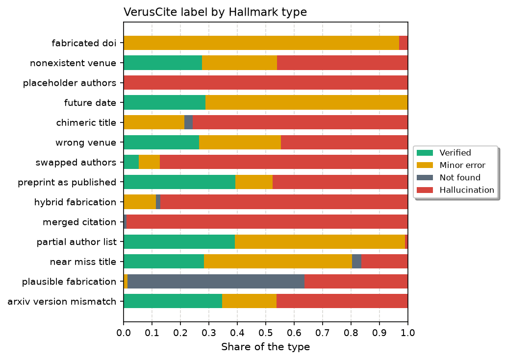
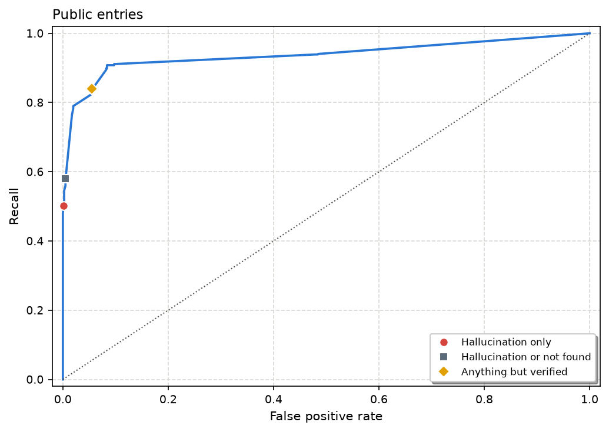

# VerusCite on the Hallmark benchmark
Andrew P. Wheeler

# Introduction

Hallmark is a benchmark for tools that check whether a bibliographic entry is real ([Kim, Brendel, and Reizinger 2026](#ref-kim2026hallmark); [Reizinger, Kim, and Brendel 2026](#ref-hallmarkrepo)). The release I use is version 1.2.4, commit c62d296. The public files are dev, test, and stress, 2,072 BibTeX entries in total. I score them as one set. VerusCite was not trained on the dev file, so holding that file out does not change the check. The hidden test file is not in the public release. I left out the cross-domain file and the ChatGPT supplement, which Hallmark scores separately from the main table.

Hallmark labels each entry valid or hallucinated, and it gives each hallucinated entry one of 14 types. The types run from a DOI that does not resolve, through a real paper cited at the wrong venue, to a fully invented reference. VerusCite is the checker I run at [veruscite.com](https://veruscite.com) ([Wheeler 2026a](#ref-veruscite)). It looks the citation up and assigns one of four labels. Verified means a matching source was found and the metadata agrees. A minor error means the same work was found, with a small difference in the year, the DOI, the author list, or the wording of the title or the venue. Not found means the search did not turn up a matching publication. Hallucination means the citation looks fabricated, or it mixes pieces of different real sources.

The two positive classes are different questions. Hallmark counts a real paper with the wrong venue, a preprint cited as the published version, a shortened author list, and an arXiv record with the venue and year mixed together as hallucinations. Those four types are 29.8% of the hallucinated entries, and Hallmark’s own paper shows that verifier rankings move when they are taken out of the positive class. VerusCite is built to call a real paper with a small metadata difference a minor error. I also expect some invented entries to come back as not found, because the search missed them, and that label is separate from hallucination. Recall of the hallucination label will be lower for both reasons.

# What was checked

I used Hallmark’s blinded entries. The blind files drop the url field, so a checker cannot treat a link as proof, and they do not contain the labels. I wrote one BibTeX file, `data/hallmark_public.bib`, with Hallmark’s key as the citation key. The labels, types, and batch assignments are in `data/labels.csv`. Nothing in the BibTeX tells the checker which entries are the positive class.

I did not send that file as one document. VerusCite marks a later entry as a duplicate when its title and authors match an earlier entry, and it copies the first verdict onto the duplicate. It does that so a bibliography that lists the same paper twice is only checked once. In this file, 411 of the 2,072 entries share a title and author list with another entry. They fall in 1,661 groups, and 290 of those groups contain both a valid entry and a hallucinated one. A changed venue, a future year, or a DOI that does not belong to the paper is often the same title and authors as the real record. One upload would have skipped the copy.

I split the file into 11 uploads. Entries that share a title and author list go in different files. A 25-entry file from this bibliography finished in 76 seconds, and the worker stops a document at 20 minutes. The largest collision-free set is 1,661 entries, so each file also has at most 300 entries. Each entry was checked once, through the API ([Wheeler 2026b](#ref-verusciteapi)). The reports are:

| Part | Entries | Report                                                                            |
|------|--------:|-----------------------------------------------------------------------------------|
| 1    |     300 | [report](https://veruscite.com/share/tHvO6qZrYrSZ42WTquiLMzHzUcpiOeAVraips9P8etw) |
| 2    |     300 | [report](https://veruscite.com/share/7r6g5IKIs7aUS8s8oSnFH6HuCvbH-usBsoP5aPmncEg) |
| 3    |     300 | [report](https://veruscite.com/share/l2Jj_j3Z3wSGCyi2wtuDl-HA_S0DLEJRLkYvjPNQzew) |
| 4    |     300 | [report](https://veruscite.com/share/AmhnS-Sy5zVsBYBBbT4s4Gc6mxHHwcAO6yWXxNu0hl4) |
| 5    |     300 | [report](https://veruscite.com/share/chgxR5WUOlysBCyCkizJkGukKS6zb4cMApQK4Hv6ghE) |
| 6    |     161 | [report](https://veruscite.com/share/5Dluo6vK-LJqeoOoEqqQ02GNTjOg-uETueJASn4Utj0) |
| 7    |     296 | [report](https://veruscite.com/share/lgZAhbaGleqLI0NQ70R5lnE7A-Sb2-yr48lZ13hWiks) |
| 8    |      91 | [report](https://veruscite.com/share/zzBAlPHCd6bpNLOpQt6FgJFG2RnSzkQiNDWYtNDT3iA) |
| 9    |      17 | [report](https://veruscite.com/share/RQqMjOfVNLaVQhdTBKW8SW8DOKq5U1CYnDDyrs3JJ1A) |
| 10   |       5 | [report](https://veruscite.com/share/ybeaKu2sx0iAjQaEXTxsX6-uNUqKQfZujlN-Q47tB2c) |
| 11   |       2 | [report](https://veruscite.com/share/TP7OTvFjVI-jnDFV9NJRHYCN7V0XIv8t81luR-E60K0) |

`scripts/02_submit.py` uploads those batches, polls until they finish, writes a public link for each, and joins the results to the labels. Passing `--combined` uploads the single file instead. That run marks the copies as duplicates, so I do not use it for the numbers below. VerusCite bills one credit per 100 citations in a document, rounded up. These uploads are 2,072 citations and 24 credits.

The scored set is the full public release: 1,260 hallucinated entries and 812 valid ones. Every entry in the joined file has one of the four labels. There are 0 duplicates in the saved results.

# Crosstab

<a href="#tbl-cross" class="quarto-xref">Table 2</a> is VerusCite’s label against Hallmark’s, for every public entry.

| Hallmark     |     n | Verified | Minor error | Not found | Hallucination |
|:-------------|------:|---------:|------------:|----------:|--------------:|
| Valid        |   812 |      767 |          41 |         3 |             1 |
| Hallucinated | 1,260 |      202 |         327 |        98 |           633 |

767 of the 812 valid entries are verified. The false calls on valid entries are 41 minor errors, 3 not found, and 1 called a hallucination. <a href="#tbl-valid-misses" class="quarto-xref">Table 6</a> lists every one of them.

Of the hallucinated entries, 633 are hallucinations, 98 are not found, 327 are minor errors, and 202 are verified. The verified hallucinated entries are the ones VerusCite accepted. The minor errors are mostly the real papers Hallmark still calls hallucinations. The not found row is the miss the hallucination label does not get credit for. The breakdown by Hallmark type is in the recall section.

# False positives

The false positives are the valid entries VerusCite did not verify: 41 minor errors, 3 not found, and 1 called a hallucination. <a href="#tbl-valid-misses" class="quarto-xref">Table 6</a> lists every one. Across each of those flags, Hallmark’s valid label is often the part that does not match the citation, and VerusCite’s flag does.

Of the 41 minor errors, 35 have an incorrect DOI, with a version string appended. Every one of those suffixes is v1. For 33 of them, the note says the suffix does not resolve and the title, authors, and year still identify the paper, so minor error is the label that rule is written to return. Appendix A names the other minor errors. A year off by one and a given name are real differences in the benchmark entry. The other 3 are author-order calls, and I need to look at how the checker reads that field.

The entry called a hallucination, “Improving Robustness using Generated Data”, lists a different DOI, 10.48550/arXiv.2104.09425. That DOI is Sehwag, Mahloujifar, Handina, Dai, Xiang, Chiang, and Mittal, “Robust Learning Meets Generative Models: Can Proxy Distributions Improve Adversarial Robustness?” The paper named in the citation is [arXiv:2110.09468](https://arxiv.org/abs/2110.09468). Hallmark marks the entry valid. The citation’s DOI is the field that is wrong. I would rather VerusCite had called this a minor error.

One of the not-found entries is a fake citation planted in the file, the canary string in the stress file. Hallmark marks it valid. It is not a paper. The other 2 not-found entries are real ICLR papers the search did not return.

# Recall

<a href="#fig-types" class="quarto-xref">Figure 1</a> and <a href="#tbl-types" class="quarto-xref">Table 3</a> are VerusCite’s label by Hallmark type, in Hallmark’s order, tier 1 then tier 2 then tier 3.

| Type                   | Tier |   n | Verified | Minor error | Not found | Hallucination |
|:-----------------------|-----:|----:|---------:|------------:|----------:|--------------:|
| fabricated doi         |    1 |  67 |        0 |          65 |         0 |             2 |
| nonexistent venue      |    1 |  76 |       21 |          20 |         0 |            35 |
| placeholder authors    |    1 |  74 |        0 |           0 |         0 |            74 |
| future date            |    1 |  59 |       17 |          42 |         0 |             0 |
| chimeric title         |    2 |  70 |        0 |          15 |         2 |            53 |
| wrong venue            |    2 |  83 |       22 |          24 |         0 |            37 |
| swapped authors        |    2 | 133 |        7 |          10 |         0 |           116 |
| preprint as published  |    2 |  61 |       24 |           8 |         0 |            29 |
| hybrid fabrication     |    2 |  62 |        0 |           7 |         1 |            54 |
| merged citation        |    2 | 105 |        0 |           0 |         1 |           104 |
| partial author list    |    2 | 102 |       40 |          61 |         0 |             1 |
| near miss title        |    3 |  92 |       26 |          48 |         3 |            15 |
| plausible fabrication  |    3 | 146 |        0 |           2 |        91 |            53 |
| arxiv version mismatch |    3 | 130 |       45 |          25 |         0 |            60 |

The current implementation will need to be amended to better catch future dates and nonexistent venues. See Appendix B for several examples of each. Many of the other articles that appendix does not cover are intentionally flagged as minor errors, including a fabricated DOI. Hallmark’s future-date entries set the year from 2030 to 2036 on a real paper. Of those, 71.2% are minor errors, and 17 were verified by a DOI lookup whose saved note does not mention the year. Of the nonexistent-venue entries, 21 were verified and 20 are minor errors. If the only problem is a date in the future, a later version of the checker will still flag the article as a minor error.

A fabricated DOI, with the rest of the citation identifying the paper, is one of those intentional minor errors. Of the 67 fabricated DOIs, 97.0% are minor errors and 3.0% are hallucinations. The hallucination label is not meant to catch that case. Wrong venue and a partial author list keep a real paper and change one field. Of the wrong-venue entries, 28.9% are minor errors and 44.6% are hallucinations. Of the partial author lists, 59.8% are minor errors. Near-miss titles sit in between. 52.2% are minor errors and 16.3% are hallucinations. Plausible fabrications are the invented entries. Of 146 plausible fabrications, 36.3% are hallucinations and 62.3% are not found.

I score three rules. The strict rule counts only VerusCite’s hallucination label as a detection. The second counts hallucination or not found, which is the strict rule plus the lookups that did not return a paper. The third counts anything other than verified, so a minor error is also a detection. Recall is the share of Hallmark’s hallucinated entries that the rule flags. The false positive rate is the share of valid entries that it flags. <a href="#tbl-rates" class="quarto-xref">Table 4</a> has both, with the counts.

| Rule                       | Caught        | Recall | False positives | FPR  |
|:---------------------------|:--------------|:-------|:----------------|:-----|
| Hallucination only         | 633 / 1,260   | 50.2%  | 1 / 812         | 0.1% |
| Hallucination or not found | 731 / 1,260   | 58.0%  | 4 / 812         | 0.5% |
| Anything but verified      | 1,058 / 1,260 | 84.0%  | 45 / 812        | 5.5% |

The hallucination label catches 633 of 1,260 hallucinated entries, recall 50.2%, and it flags 1 of 812 valid entries, a false positive rate of 0.1%. The false-positive section is where that one valid entry is discussed.

Counting not found with hallucination raises recall to 58.0% (731 of 1,260) and raises the false positive rate to 0.5% (4 of 812). The extra true positives are the 98 hallucinated entries labeled not found. The extra false positives are the 3 valid entries with the same label.

Counting minor errors as well raises recall to 84.0% and the false positive rate to 5.5%. That rule flags every entry VerusCite did not fully accept. Most of the recall it adds, relative to the not-found rule, is the real-paper types, which the minor-error rule is written to hold.

Hallmark’s published table is on the dev file alone: a DOI lookup at detection rate 0.218 and false positive rate 0.043, Gemini 2.5 Pro at 0.476 and 0.050, and bibtex-updater, which they treat as a co-designed upper bound, at 0.820 and 0.051 when abstentions are scored as valid ([Kim, Brendel, and Reizinger 2026](#ref-kim2026hallmark)). The rates above are the full public set. Their detection rate also credits a wrong venue, which VerusCite’s hallucination label does not.

<a href="#tbl-fold" class="quarto-xref">Table 5</a> recomputes the rates the two ways Hallmark uses when those four real-paper types stop counting as hallucinations. Dropping them removes the entries from the scored set. Scoring them as valid means a flag on one of them is a false positive.

| Real-paper types            | Rule                       | Recall | FPR   | Hallucinated n | Valid n |
|:----------------------------|:---------------------------|:-------|:------|---------------:|--------:|
| Dropped from the scored set | Hallucination only         | 57.2%  | 0.1%  |            884 |     812 |
| Dropped from the scored set | Hallucination or not found | 68.3%  | 0.5%  |            884 |     812 |
| Dropped from the scored set | Anything but verified      | 92.0%  | 5.5%  |            884 |     812 |
| Scored as valid             | Hallucination only         | 57.2%  | 10.8% |            884 |   1,188 |
| Scored as valid             | Hallucination or not found | 68.3%  | 11.0% |            884 |   1,188 |
| Scored as valid             | Anything but verified      | 92.0%  | 24.4% |            884 |   1,188 |

Under the strict rule, dropping those types moves recall from 50.2% to 57.2%. The false positive rate stays 0.1%, because the dropped entries were hallucinated, so the valid count does not change. Treating them as valid moves the false positive rate to 10.8%. Flagging a wrong venue is then a false alarm, which is what the hallucination label mostly avoids by putting those entries in minor error.

# A score and the ROC curve

Each entry gets one score. Verified is 0, minor error is 1, not found is 2, and hallucination is 3. Confidence is between 0 and 1, and it is how sure VerusCite is of the label it chose. I add the confidence inside that label’s slot, multiplied by 0.999, so it cannot reach the next label.

For a verified entry the piece I add is 0.999 times one minus the confidence. That is the rank plus one minus the confidence, held just short of the next label. A more confident verified call scores lower. For the other three labels the piece I add is 0.999 times the confidence, so a more confident call scores higher.

An entry flagged as verified with confidence 0.90 gets a score of 0.0999. An entry flagged as verified with confidence 0.20 gets a score of 0.7992. An entry flagged as a minor error with confidence 0.80 gets a score of 1.7992. An entry flagged as a minor error with confidence 0.40 gets a score of 1.3996. An entry flagged as not found with confidence 0.60 gets a score of 2.5994. An entry flagged as a hallucination with confidence 0.70 gets a score of 3.6993.

Every verified score is below 1. Every minor error is at least 1 and below 2. Every not found is at least 2 and below 3. Every hallucination is at least 3 and below 4.

<a href="#fig-roc" class="quarto-xref">Figure 2</a> is an ordinary ROC curve on that score. Hallmark’s hallucinated label is the positive class. I sort the entries from the highest score to the lowest. At each distinct score, the threshold flags every entry at or above it. Recall is the share of hallucinated entries flagged. The false positive rate is the share of valid entries flagged. Those pairs are the curve. The routine is `sklearn.metrics.roc_curve`. Points that lie on the straight line between their neighbors are left off the plot. The line is the same either way.

The area under the curve is 0.937. Using only the four label numbers, with confidence ignored, the area is 0.907.

The marked points are the three rules in <a href="#tbl-rates" class="quarto-xref">Table 4</a>. They use the label and ignore confidence. Scores of 3 or above are the hallucination label, recall 50.2% and false positive rate 0.1%. Scores of 2 or above add not found. Scores of 1 or above add minor errors. Between those points the curve is only the confidence order inside one label. The area is larger than the hallucination label’s recall because a minor error still ranks above a verified entry, and a not found still ranks above a minor error.

# Limits

This is a check of bibliographic metadata, which is also what Hallmark measures. I did not ask whether a manuscript’s claim is supported by the cited paper. The public entries are mostly papers from major machine-learning venues. A bibliography of books, reports, or legal citations would land in different places, and not found would be more common for work that is real and absent from the indexes VerusCite searches.

The duplicate rule is a property of the product, not of the benchmark. A user who uploads one file in which the same title and authors appear twice will get one check. I split the file so the numbers above are one check per entry. The links in <a href="#tbl-links" class="quarto-xref">Table 1</a> are that run.

Hallmark has not settled whether a real paper with the wrong venue is a hallucination. <a href="#tbl-fold" class="quarto-xref">Table 5</a> is there so the rates can be read either way. I would use the hallucination label when the question is whether the reference was invented, and I would read minor errors as a separate list of metadata to fix.

# AI use disclosure

The code, the API run, and the text were produced with Grok (xAI, Grok 4.7) under my direction. I specified the benchmark, the use of the VerusCite API, the crosstab of VerusCite’s labels with Hallmark’s, separate sections for the false positives and for recall, the AUC, the worked examples for how that ROC score is built, the walk-through of the valid entries in those false-positive counts, the two appendices with the full citation and the checker’s note, the count of version-suffixed DOIs among those valid misses, and the Figure 1 legend and gridlines. The split into collision-free batches was required by VerusCite’s duplicate rule, which would otherwise have skipped entries that share a title and author list. All numbers and figures are computed from the scripts and the saved API results in the repository.

# Appendix A. Valid entries that were not verified

The false-positive section is the reading of these rows. Hallmark marks the entries in <a href="#tbl-valid-misses" class="quarto-xref">Table 6</a> valid. VerusCite did not verify them: 41 minor errors, 3 not found, and 1 called a hallucination.

A fabricated DOI is a minor error when the rest of the citation identifies the paper. I wrote that rule so a bad identifier would be a field to fix, and the paper would still count as found. An unresolved DOI is the same call. Of the 45 entries in this table, 35 append a version number to the DOI. Every one of those suffixes is v1. For 33 of them, the note says the suffix does not resolve and the title, authors, and year match the preprint. The other 2 still end in that suffix, and the note names another field. “Capability-Oriented Training Induced Alignment Risk” is a preprint title that changed between versions. “Query-focused and Memory-aware Reranker for Long Context Processing” is an author list: the citation matches the v1 author list, including Weiping Wang, and the note compares it with a later list.

A year off by one is a minor error for the same reason. The paper is the one cited, and the year is the field that is wrong. That rule accounts for 1 of these valid entries, “NAS-Bench-201: Extending the Scope of Reproducible Neural Architecture Search”. The citation says 2021. The note says the ICLR page is the 2020 conference. That is a real year error. Hallmark’s future-date type is a larger shift, the year set from 2030 to 2036, and 71.2% of those entries are minor errors when the year is checked against the record.

“Hybrid RL: Using both offline and online data can make RL efficient” is a real given-name difference. The citation says Drew Bagnell. The note says the Microsoft Research page lists J. Andrew Bagnell.

“Towards Transferable Targeted Adversarial Examples” lists Kui Ren. That is the name on the CVPR paper. The checker’s note says the IEEE Xplore page lists six authors and leaves Kui Ren off. One IEEE HTML rendering of the same record shows Kui Rent. The benchmark spelling matches the paper. The minor-error call is the short IEEE author list.

The other 3 minor errors are author-order calls: “Learning on Large-scale Text-attributed Graphs via Variational Inference”, “Sample Efficiency Matters: A Benchmark for Practical Molecular Optimization”, and “Earthformer: Exploring Space-Time Transformers for Earth System Forecasting”. The citation order matches the proceedings order on the pages I checked. “Learning on Large-scale Text-attributed Graphs via Variational Inference” puts Xing Xie before Jian Tang, which is the ICLR order, and the note says the citation does the reverse. The note on “Sample Efficiency Matters: A Benchmark for Practical Molecular Optimization” says the order differs and that the NeurIPS page confirms the cited order. I need to look at how the checker is reading author order.

The three not-found rows are the canary string and the two papers the search missed. The hallucination row is the DOI that resolves to a different paper. The trace is the checker’s full note.

| VerusCite     | Citation                                                                                                                                                                                                                                                                                            | DOI                                                                                                                                                                                                                 | Trace                                                                                                                                                                                                                                                                                                                                                                                                                                                                                                                                                                                                                                                                                                                                                                                                                                                                                                                                                                                                                                                                                                                                                                                                                                                                                           |
|:--------------|:----------------------------------------------------------------------------------------------------------------------------------------------------------------------------------------------------------------------------------------------------------------------------------------------------|:--------------------------------------------------------------------------------------------------------------------------------------------------------------------------------------------------------------------|:------------------------------------------------------------------------------------------------------------------------------------------------------------------------------------------------------------------------------------------------------------------------------------------------------------------------------------------------------------------------------------------------------------------------------------------------------------------------------------------------------------------------------------------------------------------------------------------------------------------------------------------------------------------------------------------------------------------------------------------------------------------------------------------------------------------------------------------------------------------------------------------------------------------------------------------------------------------------------------------------------------------------------------------------------------------------------------------------------------------------------------------------------------------------------------------------------------------------------------------------------------------------------------------------|
| Minor error   | Yujun Zhou, Yue Huang, Han Bao, Kehan Guo, Zhenwen Liang, Pin-Yu Chen, Tian Gao, Werner Geyer, Nuno Moniz, Nitesh V Chawla, and Xiangliang Zhang. Capability-Oriented Training Induced Alignment Risk. 2026.                                                                                        | [10.48550/arXiv.2602.12124v1](https://doi.org/10.48550/arXiv.2602.12124v1) Found [10.48550/arXiv.2602.12124](https://doi.org/10.48550/arXiv.2602.12124) [article](https://arxiv.org/abs/2602.12124)                 | Same arXiv/preprint work at arxiv_static (authors match), but the cited title differs from the current official title (similarity 0.28) — typically a version retitle; minor_error, not a different paper.                                                                                                                                                                                                                                                                                                                                                                                                                                                                                                                                                                                                                                                                                                                                                                                                                                                                                                                                                                                                                                                                                      |
| Minor error   | Xiaoxiao Wang, Chunxiao Li, Junying Wang, Yijin Guo, Zijian Chen, Chunyi Li, Xiaohong Liu, Zicheng Zhang, and Guangtao Zhai. STAR : Bridging Statistical and Agentic Reasoning for Large Model Performance Prediction. 2026.                                                                        | [10.48550/arXiv.2602.12143v1](https://doi.org/10.48550/arXiv.2602.12143v1) Found [10.48550/arXiv.2602.12143](https://doi.org/10.48550/arXiv.2602.12143) [article](https://arxiv.org/abs/2602.12143)                 | Verified via arXiv id 2602.12143. Cited DOI (10.48550/arXiv.2602.12143v1) does not resolve (CrossRef/DataCite/doi.org) — cannot remain verified (bad/unregistered DOI). Identity of the work is left to bibliographic match notes.                                                                                                                                                                                                                                                                                                                                                                                                                                                                                                                                                                                                                                                                                                                                                                                                                                                                                                                                                                                                                                                              |
| Minor error   | Bowei He, Yankai Chen, Xiaokun Zhang, Linghe Kong, Philip S. Yu, Xue Liu, and Chen Ma. Pedagogically-Inspired Data Synthesis for Language Model Knowledge Distillation. 2026.                                                                                                                       | [10.48550/arXiv.2602.12172v1](https://doi.org/10.48550/arXiv.2602.12172v1) Found [10.48550/arXiv.2602.12172](https://doi.org/10.48550/arXiv.2602.12172) [article](https://arxiv.org/abs/2602.12172)                 | Verified via arXiv id 2602.12172. Cited DOI (10.48550/arXiv.2602.12172v1) does not resolve (CrossRef/DataCite/doi.org) — cannot remain verified (bad/unregistered DOI). Identity of the work is left to bibliographic match notes.                                                                                                                                                                                                                                                                                                                                                                                                                                                                                                                                                                                                                                                                                                                                                                                                                                                                                                                                                                                                                                                              |
| Minor error   | Ibne Farabi Shihab, Sanjeda Akter, and Anuj Sharma. Learning to Forget Attention: Memory Consolidation for Adaptive Compute Reduction. 2026.                                                                                                                                                        | [10.48550/arXiv.2602.12204v1](https://doi.org/10.48550/arXiv.2602.12204v1) Found [10.48550/arXiv.2602.12204](https://doi.org/10.48550/arXiv.2602.12204) [article](https://arxiv.org/abs/2602.12204)                 | Verified via arXiv id 2602.12204. Cited DOI (10.48550/arXiv.2602.12204v1) does not resolve (CrossRef/DataCite/doi.org) — cannot remain verified (bad/unregistered DOI). Identity of the work is left to bibliographic match notes.                                                                                                                                                                                                                                                                                                                                                                                                                                                                                                                                                                                                                                                                                                                                                                                                                                                                                                                                                                                                                                                              |
| Minor error   | Christian Internò, Jumpei Yamaguchi, Loren Amdahl-Culleton, Markus Olhofer, David Klindt, and Barbara Hammer. The Observer Effect in World Models: Invasive Adaptation Corrupts Latent Physics. 2026.                                                                                               | [10.48550/arXiv.2602.12218v1](https://doi.org/10.48550/arXiv.2602.12218v1) Found [10.48550/arXiv.2602.12218](https://doi.org/10.48550/arXiv.2602.12218) [article](https://arxiv.org/abs/2602.12218)                 | Verified via arXiv id 2602.12218. Cited DOI (10.48550/arXiv.2602.12218v1) does not resolve (CrossRef/DataCite/doi.org) — cannot remain verified (bad/unregistered DOI). Identity of the work is left to bibliographic match notes.                                                                                                                                                                                                                                                                                                                                                                                                                                                                                                                                                                                                                                                                                                                                                                                                                                                                                                                                                                                                                                                              |
| Minor error   | Xin Ju, Jiachen Yao, Anima Anandkumar, Sally M. Benson, and Gege Wen. Function-Space Decoupled Diffusion for Forward and Inverse Modeling in Carbon Capture and Storage. 2026.                                                                                                                      | [10.48550/arXiv.2602.12274v1](https://doi.org/10.48550/arXiv.2602.12274v1) Found [10.48550/arXiv.2602.12274](https://doi.org/10.48550/arXiv.2602.12274) [article](https://arxiv.org/abs/2602.12274)                 | Verified via arXiv id 2602.12274. Cited DOI (10.48550/arXiv.2602.12274v1) does not resolve (CrossRef/DataCite/doi.org) — cannot remain verified (bad/unregistered DOI). Identity of the work is left to bibliographic match notes.                                                                                                                                                                                                                                                                                                                                                                                                                                                                                                                                                                                                                                                                                                                                                                                                                                                                                                                                                                                                                                                              |
| Minor error   | Dalyapraz Manatova, Pablo Moriano, and L. Jean Camp. Community Concealment from Unsupervised Graph Learning-Based Clustering. 2026.                                                                                                                                                                 | [10.48550/arXiv.2602.12250v1](https://doi.org/10.48550/arXiv.2602.12250v1) Found [10.48550/arXiv.2602.12250](https://doi.org/10.48550/arXiv.2602.12250) [article](https://arxiv.org/abs/2602.12250v1)               | The direct arXiv v1 record confirms the cited title, all three authors, and the 2026 submission date. The citation’s DOI includes the version suffix “v1”; arXiv’s record identifies the DOI without that suffix as 10.48550/arXiv.2602.12250. The DOI with the suffix could not be retrieved, while the base DOI resolved to the arXiv record. The base DOI record shows a later v2 title, “Community Concealment from Graph Neural Networks,” but the cited title is confirmed as the v1 title, so this is a versioned preprint title change, not a different work. Minor error: the cited DOI is incorrectly version-suffixed.                                                                                                                                                                                                                                                                                                                                                                                                                                                                                                                                                                                                                                                               |
| Minor error   | Yang Cai, Haipeng Luo, Chen-Yu Wei, and Weiqiang Zheng. Is Online Linear Optimization Sufficient for Strategic Robustness?. 2026.                                                                                                                                                                   | [10.48550/arXiv.2602.12253v1](https://doi.org/10.48550/arXiv.2602.12253v1) Found [10.48550/arXiv.2602.12253](https://doi.org/10.48550/arXiv.2602.12253) [article](https://arxiv.org/abs/2602.12253)                 | Verified via arXiv id 2602.12253. Cited DOI (10.48550/arXiv.2602.12253v1) does not resolve (CrossRef/DataCite/doi.org) — cannot remain verified (bad/unregistered DOI). Identity of the work is left to bibliographic match notes.                                                                                                                                                                                                                                                                                                                                                                                                                                                                                                                                                                                                                                                                                                                                                                                                                                                                                                                                                                                                                                                              |
| Minor error   | Jianan Zhao, Meng Qu, Chaozhuo Li, Hao Yan, Qian Liu, Rui Li, Xing Xie, and Jian Tang. Learning on Large-scale Text-attributed Graphs via Variational Inference. ICLR, 2023.                                                                                                                        | [article](https://openreview.net/forum?id=q0nmYciuuZN)                                                                                                                                                              | The direct ICLR OpenReview record confirms the cited title, all eight authors, and the 2023 ICLR venue. The only identified error is author order: the official record places Xing Xie before Jian Tang, while the citation places Jian Tang before Xing Xie. The official OpenReview record also provides the title and metadata in its page content. Source URL was fetched and inspected.                                                                                                                                                                                                                                                                                                                                                                                                                                                                                                                                                                                                                                                                                                                                                                                                                                                                                                    |
| Minor error   | Jianke Yang, Ohm Venkatachalam, Mohammad Kianezhad, Sharvaree Vadgama, and Rose Yu. Think like a Scientist: Physics-guided LLM Agent for Equation Discovery. 2026.                                                                                                                                  | [10.48550/arXiv.2602.12259v1](https://doi.org/10.48550/arXiv.2602.12259v1) Found [10.48550/arXiv.2602.12259](https://doi.org/10.48550/arXiv.2602.12259) [article](https://arxiv.org/abs/2602.12259)                 | Verified via arXiv id 2602.12259. Cited DOI (10.48550/arXiv.2602.12259v1) does not resolve (CrossRef/DataCite/doi.org) — cannot remain verified (bad/unregistered DOI). Identity of the work is left to bibliographic match notes.                                                                                                                                                                                                                                                                                                                                                                                                                                                                                                                                                                                                                                                                                                                                                                                                                                                                                                                                                                                                                                                              |
| Minor error   | Yurong Chen, Yu He, Michael I. Jordan, and Fan Yao. How Sampling Shapes LLM Alignment: From One-Shot Optima to Iterative Dynamics. 2026.                                                                                                                                                            | [10.48550/arXiv.2602.12180v1](https://doi.org/10.48550/arXiv.2602.12180v1) Found [10.48550/arXiv.2602.12180](https://doi.org/10.48550/arXiv.2602.12180) [article](https://arxiv.org/abs/2602.12180)                 | Verified via arXiv id 2602.12180. Cited DOI (10.48550/arXiv.2602.12180v1) does not resolve (CrossRef/DataCite/doi.org) — cannot remain verified (bad/unregistered DOI). Identity of the work is left to bibliographic match notes.                                                                                                                                                                                                                                                                                                                                                                                                                                                                                                                                                                                                                                                                                                                                                                                                                                                                                                                                                                                                                                                              |
| Minor error   | Wenhao Gao, Tianfan Fu, Jimeng Sun, and Connor W. Coley. Sample Efficiency Matters: A Benchmark for Practical Molecular Optimization. NeurIPS, 2022.                                                                                                                                                | Found [10.52202/068431-1551](https://doi.org/10.52202/068431-1551) [article](https://papers.neurips.cc/paper_files/paper/2022/hash/8644353f7d307baaf29bc1e56fe8e0ec-Abstract-Datasets_and_Benchmarks.html)          | Title comparison: exact match with the official NeurIPS proceedings record. Venue comparison: the citation’s “NeurIPS” is a short form for the same proceedings series, not a different venue. Author comparison: all four people match, but their listed order differs from the official proceedings author order; this is a concrete author-order error. The same underlying work is therefore identified, with a minor bibliographic error. Direct sources inspected: the official NeurIPS proceedings page and the DOI landing page, both of which identify the title and proceedings; the NeurIPS page confirms the cited author sequence and venue. The DOI record gives pages 21342–21357 and identifies Advances in Neural Information Processing Systems 35.                                                                                                                                                                                                                                                                                                                                                                                                                                                                                                                           |
| Minor error   | Yangzhuo Li, Shengpeng Ji, Yifu Chen, Tianle Liang, Haorong Ying, Yule Wang, Junbo Li, Jun Fang, and Zhou Zhao. WavBench: Benchmarking Reasoning, Colloquialism, and Paralinguistics for End-to-End Spoken Dialogue Models. 2026.                                                                   | [10.48550/arXiv.2602.12135v1](https://doi.org/10.48550/arXiv.2602.12135v1) Found [10.48550/arXiv.2602.12135](https://doi.org/10.48550/arXiv.2602.12135) [article](https://arxiv.org/abs/2602.12135)                 | Verified via arXiv id 2602.12135. Cited DOI (10.48550/arXiv.2602.12135v1) does not resolve (CrossRef/DataCite/doi.org) — cannot remain verified (bad/unregistered DOI). Identity of the work is left to bibliographic match notes.                                                                                                                                                                                                                                                                                                                                                                                                                                                                                                                                                                                                                                                                                                                                                                                                                                                                                                                                                                                                                                                              |
| Minor error   | Nicholas Lee, Lutfi Eren Erdogan, Chris Joseph John, Surya Krishnapillai, Michael W. Mahoney, Kurt Keutzer, and Amir Gholami. Agentic Test-Time Scaling for WebAgents. 2026.                                                                                                                        | [10.48550/arXiv.2602.12276v1](https://doi.org/10.48550/arXiv.2602.12276v1) Found [10.48550/arXiv.2602.12276](https://doi.org/10.48550/arXiv.2602.12276) [article](https://arxiv.org/abs/2602.12276)                 | Verified via arXiv id 2602.12276. Cited DOI (10.48550/arXiv.2602.12276v1) does not resolve (CrossRef/DataCite/doi.org) — cannot remain verified (bad/unregistered DOI). Identity of the work is left to bibliographic match notes.                                                                                                                                                                                                                                                                                                                                                                                                                                                                                                                                                                                                                                                                                                                                                                                                                                                                                                                                                                                                                                                              |
| Minor error   | Miaosen Zhang, Yishan Liu, Shuxia Lin, Xu Yang, Qi Dai, Chong Luo, Weihao Jiang, Peng Hou, Anxiang Zeng, Xin Geng, and Baining Guo. Towards On-Policy SFT: Distribution Discriminant Theory and its Applications in LLM Training. 2026.                                                             | [10.48550/arXiv.2602.12222v1](https://doi.org/10.48550/arXiv.2602.12222v1) Found [10.48550/arXiv.2602.12222](https://doi.org/10.48550/arXiv.2602.12222) [article](https://arxiv.org/abs/2602.12222)                 | Verified via arXiv id 2602.12222. Cited DOI (10.48550/arXiv.2602.12222v1) does not resolve (CrossRef/DataCite/doi.org) — cannot remain verified (bad/unregistered DOI). Identity of the work is left to bibliographic match notes.                                                                                                                                                                                                                                                                                                                                                                                                                                                                                                                                                                                                                                                                                                                                                                                                                                                                                                                                                                                                                                                              |
| Minor error   | Yongcun Song, Xiaoming Yuan, Hangrui Yue, and Tianyou Zeng. Learning to Control: The iUzawa-Net for Nonsmooth Optimal Control of Linear PDEs. 2026.                                                                                                                                                 | [10.48550/arXiv.2602.12273v1](https://doi.org/10.48550/arXiv.2602.12273v1) Found [10.48550/arXiv.2602.12273](https://doi.org/10.48550/arXiv.2602.12273) [article](https://arxiv.org/abs/2602.12273)                 | Verified via arXiv id 2602.12273. Cited DOI (10.48550/arXiv.2602.12273v1) does not resolve (CrossRef/DataCite/doi.org) — cannot remain verified (bad/unregistered DOI). Identity of the work is left to bibliographic match notes.                                                                                                                                                                                                                                                                                                                                                                                                                                                                                                                                                                                                                                                                                                                                                                                                                                                                                                                                                                                                                                                              |
| Minor error   | Krish Agarwal, Zhuoming Chen, Cheng Luo, Yongqi Chen, Haizhong Zheng, Xun Huang, Atri Rudra, and Beidi Chen. MonarchRT: Efficient Attention for Real-Time Video Generation. 2026.                                                                                                                   | [10.48550/arXiv.2602.12271v1](https://doi.org/10.48550/arXiv.2602.12271v1) Found [10.48550/arXiv.2602.12271](https://doi.org/10.48550/arXiv.2602.12271) [article](https://arxiv.org/abs/2602.12271)                 | Verified via arXiv id 2602.12271. Cited DOI (10.48550/arXiv.2602.12271v1) does not resolve (CrossRef/DataCite/doi.org) — cannot remain verified (bad/unregistered DOI). Identity of the work is left to bibliographic match notes.                                                                                                                                                                                                                                                                                                                                                                                                                                                                                                                                                                                                                                                                                                                                                                                                                                                                                                                                                                                                                                                              |
| Minor error   | Tianzhu Ye, Li Dong, Xun Wu, Shaohan Huang, and Furu Wei. On-Policy Context Distillation for Language Models. 2026.                                                                                                                                                                                 | [10.48550/arXiv.2602.12275v1](https://doi.org/10.48550/arXiv.2602.12275v1) Found [10.48550/arXiv.2602.12275](https://doi.org/10.48550/arXiv.2602.12275) [article](https://arxiv.org/abs/2602.12275)                 | Verified via arXiv id 2602.12275. Cited DOI (10.48550/arXiv.2602.12275v1) does not resolve (CrossRef/DataCite/doi.org) — cannot remain verified (bad/unregistered DOI). Identity of the work is left to bibliographic match notes.                                                                                                                                                                                                                                                                                                                                                                                                                                                                                                                                                                                                                                                                                                                                                                                                                                                                                                                                                                                                                                                              |
| Minor error   | Kaitlyn Zhou, Martijn Bartelds, Federico Bianchi, and James Zou. “Sorry, I Didn’t Catch That”: How Speech Models Miss What Matters Most. 2026.                                                                                                                                                      | [10.48550/arXiv.2602.12249v1](https://doi.org/10.48550/arXiv.2602.12249v1) Found [10.48550/arXiv.2602.12249](https://doi.org/10.48550/arXiv.2602.12249) [article](https://arxiv.org/abs/2602.12249)                 | Verified via arXiv id 2602.12249. Cited DOI (10.48550/arXiv.2602.12249v1) does not resolve (CrossRef/DataCite/doi.org) — cannot remain verified (bad/unregistered DOI). Identity of the work is left to bibliographic match notes.                                                                                                                                                                                                                                                                                                                                                                                                                                                                                                                                                                                                                                                                                                                                                                                                                                                                                                                                                                                                                                                              |
| Minor error   | Manjunath Kudlur, Evan King, James Wang, and Pete Warden. Moonshine v2: Ergodic Streaming Encoder ASR for Latency-Critical Speech Applications. 2026.                                                                                                                                               | [10.48550/arXiv.2602.12241v1](https://doi.org/10.48550/arXiv.2602.12241v1) Found [10.48550/arXiv.2602.12241](https://doi.org/10.48550/arXiv.2602.12241) [article](https://arxiv.org/abs/2602.12241)                 | Verified via arXiv id 2602.12241. Cited DOI (10.48550/arXiv.2602.12241v1) does not resolve (CrossRef/DataCite/doi.org) — cannot remain verified (bad/unregistered DOI). Identity of the work is left to bibliographic match notes.                                                                                                                                                                                                                                                                                                                                                                                                                                                                                                                                                                                                                                                                                                                                                                                                                                                                                                                                                                                                                                                              |
| Minor error   | Ralph Krüger. A technical curriculum on language-oriented artificial intelligence in translation and specialised communication. 2026.                                                                                                                                                               | [10.48550/arXiv.2602.12251v1](https://doi.org/10.48550/arXiv.2602.12251v1) Found [10.48550/arXiv.2602.12251](https://doi.org/10.48550/arXiv.2602.12251) [article](https://arxiv.org/abs/2602.12251)                 | Verified via arXiv id 2602.12251. Cited DOI (10.48550/arXiv.2602.12251v1) does not resolve (CrossRef/DataCite/doi.org) — cannot remain verified (bad/unregistered DOI). Identity of the work is left to bibliographic match notes.                                                                                                                                                                                                                                                                                                                                                                                                                                                                                                                                                                                                                                                                                                                                                                                                                                                                                                                                                                                                                                                              |
| Minor error   | Zhibo Wang, Hongshan Yang, Yunhe Feng, Peng Sun, Hengchang Guo, Zhifei Zhang, and Kui Ren. Towards Transferable Targeted Adversarial Examples. CVPR, 2023.                                                                                                                                          | [10.1109/CVPR52729.2023.01967](https://doi.org/10.1109/CVPR52729.2023.01967) [article](https://doi.org/10.1109/cvpr52729.2023.01967)                                                                                | The DOI landing page at IEEE Xplore directly confirms the cited title, 2023 CVPR venue, year, and DOI, but lists six authors and omits Kui Ren. The citation presents its author list without an et al. marker, so the added author is a concrete author-list error. The same underlying paper is identified; the author discrepancy supports minor_error, not hallucination. A separate IEEE Xplore author-details search result also displays the work with the same six listed authors. The DOI page is the primary evidence; a separate attempted IEEE document URL was blocked by robots and was not used as evidence.                                                                                                                                                                                                                                                                                                                                                                                                                                                                                                                                                                                                                                                                     |
| Minor error   | Yashas Shende, Aritra Das, Reva Laxmi Chauhan, Arghya Pathak, and Debayan Gupta. Oscillators Are All You Need: Irregular Time Series Modelling via Damped Harmonic Oscillators with Closed-Form Solutions. 2026.                                                                                    | [10.48550/arXiv.2602.12139v1](https://doi.org/10.48550/arXiv.2602.12139v1) Found [10.48550/arXiv.2602.12139](https://doi.org/10.48550/arXiv.2602.12139) [article](https://arxiv.org/abs/2602.12139)                 | Verified via arXiv id 2602.12139. Cited DOI (10.48550/arXiv.2602.12139v1) does not resolve (CrossRef/DataCite/doi.org) — cannot remain verified (bad/unregistered DOI). Identity of the work is left to bibliographic match notes.                                                                                                                                                                                                                                                                                                                                                                                                                                                                                                                                                                                                                                                                                                                                                                                                                                                                                                                                                                                                                                                              |
| Minor error   | Duy Nguyen, Jiachen Yao, Jiayun Wang, Julius Berner, and Animashree Anandkumar. Self-Supervised Learning via Flow-Guided Neural Operator on Time-Series Data. 2026.                                                                                                                                 | [10.48550/arXiv.2602.12267v1](https://doi.org/10.48550/arXiv.2602.12267v1) Found [10.48550/arXiv.2602.12267](https://doi.org/10.48550/arXiv.2602.12267) [article](https://arxiv.org/abs/2602.12267)                 | Verified via arXiv id 2602.12267. Cited DOI (10.48550/arXiv.2602.12267v1) does not resolve (CrossRef/DataCite/doi.org) — cannot remain verified (bad/unregistered DOI). Identity of the work is left to bibliographic match notes.                                                                                                                                                                                                                                                                                                                                                                                                                                                                                                                                                                                                                                                                                                                                                                                                                                                                                                                                                                                                                                                              |
| Minor error   | Yuqing Li, Jiangnan Li, Mo Yu, Guoxuan Ding, Zheng Lin, Weiping Wang, and Jie Zhou. Query-focused and Memory-aware Reranker for Long Context Processing. 2026.                                                                                                                                      | [10.48550/arXiv.2602.12192v1](https://doi.org/10.48550/arXiv.2602.12192v1) Found [10.48550/arXiv.2602.12192](https://doi.org/10.48550/arXiv.2602.12192) [article](https://arxiv.org/abs/2602.12192)                 | CrossRef arxiv_static matches title/DOI (score: 1.00), but cited author identities disagree with the official list. Unmatched cited author(s): Weiping Wang. Official authors: Yuqing Li, Jiangnan Li, Mo Yu, Guoxuan Ding, Yanyu Chen, Zheng Lin, Wei Zhang, Jie Zhou.                                                                                                                                                                                                                                                                                                                                                                                                                                                                                                                                                                                                                                                                                                                                                                                                                                                                                                                                                                                                                         |
| Minor error   | Xubin Wang and Weijia Jia. Meta-Sel: Efficient Demonstration Selection for In-Context Learning via Supervised Meta-Learning. 2026.                                                                                                                                                                  | [10.48550/arXiv.2602.12123v1](https://doi.org/10.48550/arXiv.2602.12123v1) Found [10.48550/arXiv.2602.12123](https://doi.org/10.48550/arXiv.2602.12123) [article](https://arxiv.org/abs/2602.12123)                 | Verified via arXiv id 2602.12123. Cited DOI (10.48550/arXiv.2602.12123v1) does not resolve (CrossRef/DataCite/doi.org) — cannot remain verified (bad/unregistered DOI). Identity of the work is left to bibliographic match notes.                                                                                                                                                                                                                                                                                                                                                                                                                                                                                                                                                                                                                                                                                                                                                                                                                                                                                                                                                                                                                                                              |
| Minor error   | Leon Liangyu Chen, Haoyu Ma, Zhipeng Fan, Ziqi Huang, Animesh Sinha, Xiaoliang Dai, Jialiang Wang, Zecheng He, Jianwei Yang, Chunyuan Li, Junzhe Sun, Chu Wang, Serena Yeung-Levy, and Felix Juefei-Xu. UniT: Unified Multimodal Chain-of-Thought Test-time Scaling. 2026.                          | [10.48550/arXiv.2602.12279v1](https://doi.org/10.48550/arXiv.2602.12279v1) Found [10.48550/arXiv.2602.12279](https://doi.org/10.48550/arXiv.2602.12279) [article](https://arxiv.org/abs/2602.12279)                 | Verified via arXiv id 2602.12279. Cited DOI (10.48550/arXiv.2602.12279v1) does not resolve (CrossRef/DataCite/doi.org) — cannot remain verified (bad/unregistered DOI). Identity of the work is left to bibliographic match notes.                                                                                                                                                                                                                                                                                                                                                                                                                                                                                                                                                                                                                                                                                                                                                                                                                                                                                                                                                                                                                                                              |
| Minor error   | Zijing Ou, Jacob Si, Junyi Zhu, Ondrej Bohdal, Mete Ozay, Taha Ceritli, and Yingzhen Li. Diffusion Alignment Beyond KL: Variance Minimisation as Effective Policy Optimiser. 2026.                                                                                                                  | [10.48550/arXiv.2602.12229v1](https://doi.org/10.48550/arXiv.2602.12229v1) Found [10.48550/arXiv.2602.12229](https://doi.org/10.48550/arXiv.2602.12229) [article](https://arxiv.org/abs/2602.12229)                 | Verified via arXiv id 2602.12229. Cited DOI (10.48550/arXiv.2602.12229v1) does not resolve (CrossRef/DataCite/doi.org) — cannot remain verified (bad/unregistered DOI). Identity of the work is left to bibliographic match notes.                                                                                                                                                                                                                                                                                                                                                                                                                                                                                                                                                                                                                                                                                                                                                                                                                                                                                                                                                                                                                                                              |
| Minor error   | Mathieu Sibue, Andres Muñoz Garza, Samuel Mensah, Pranav Shetty, Zhiqiang Ma, Xiaomo Liu, and Manuela Veloso. ExStrucTiny: A Benchmark for Schema-Variable Structured Information Extraction from Document Images. 2026.                                                                            | [10.48550/arXiv.2602.12203v1](https://doi.org/10.48550/arXiv.2602.12203v1) Found [10.18653/v1/2026.eacl-long.265](https://doi.org/10.18653/v1/2026.eacl-long.265) [article](https://arxiv.org/abs/2602.12203)       | Title comparison: exact match on both the official arXiv abstract page and the ACL Anthology record. Venue comparison: the raw citation identifies an arXiv version through its DOI field, rather than naming a journal or proceedings venue; the arXiv record confirms the cited work and notes “EACL 2026, main conference,” and ACL Anthology gives the proceedings venue. Author comparison: all seven cited authors match the official records, with only a diacritic difference. The arXiv page says to cite the preprint as arXiv:2602.12203 (or arXiv:2602.12203v1 for that version) and gives the arXiv-issued DOI as https://doi.org/10.48550/arXiv.2602.12203, without the cited DOI’s trailing “v1.” Thus the work is real and identified, but the DOI as written is not the official DOI form; this is a minor identifier error, not a different-work finding. The arXiv DOI URL was not retrievable in the URL fetch; the official arXiv abstract page was accessible and directly confirms the title, authors, version, and DOI. Official sources visited: https://arxiv.org/abs/2602.12203 and https://doi.org/10.18653/v1/2026.eacl-long.265                                                                                                                                   |
| Minor error   | Zhihan Gao, Xingjian Shi, Hao Wang, Yi Zhu, Yuyang Wang, Mu Li, and Dit-Yan Yeung. Earthformer: Exploring Space-Time Transformers for Earth System Forecasting. NeurIPS, 2022.                                                                                                                      | Found [10.52202/068431-1841](https://doi.org/10.52202/068431-1841) [article](https://papers.neurips.cc/paper_files/paper/2022/hash/a2affd71d15e8fedffe18d0219f4837a-Abstract-Conference.html)                       | Title comparison: the cited title matches the title on the official NeurIPS proceedings page and DOI landing page. Venue comparison: the citation’s “NeurIPS” is a valid short form for the official proceedings record, which identifies Advances in Neural Information Processing Systems 35 (NeurIPS 2022) Main Conference Track. Author comparison: all seven cited people appear on the official record, though in a different order; the DOI record’s ordering differs from the citation, so under the applicable author-order rule this is a minor bibliographic error. The same underlying work is confirmed by the official NeurIPS proceedings page and the DOI landing page, which reports the conference, year, title, authors, and pages 25390–25403. Verdict: minor_error for author order only; the work itself is the same.                                                                                                                                                                                                                                                                                                                                                                                                                                                     |
| Minor error   | Peter J Barclay. A Rule-based Computational Model for Gaidhlig Morphology. 2026.                                                                                                                                                                                                                    | [10.48550/arXiv.2602.12132v1](https://doi.org/10.48550/arXiv.2602.12132v1) Found [10.48550/arXiv.2602.12132](https://doi.org/10.48550/arXiv.2602.12132) [article](https://arxiv.org/abs/2602.12132)                 | The arXiv abstract page directly identifies arXiv:2602.12132v1, submitted 12 February 2026, with the cited title and author; it also states that a revised version will be published at ICAART 2026. The cited DOI suffix includes “v1”; arXiv’s displayed DOI is 10.48550/arXiv.2602.12132 without the version suffix, which is a version-specific citation form rather than a different work. SciTePress’s publisher record independently identifies the same paper in the ICAART proceedings, with the title “A Rule-Based Computational Model for Gàidhlig Morphology,” author Peter J. Barclay, and proceedings DOI 10.5220/0014654900004052. The cited raw entry does not name a journal or proceedings venue, but it explicitly cites the arXiv DOI, so it is properly treated as an arXiv preprint citation. Title comparison: substantive wording matches; capitalization and the accent in Gàidhlig are rendering differences. Venue comparison: arXiv is confirmed as the cited preprint source. Author comparison: matches. The work is fundamentally the same. Verdict: verified. Cited DOI (10.48550/arXiv.2602.12132v1) does not resolve (CrossRef/DataCite/doi.org) — cannot remain verified (bad/unregistered DOI). Identity of the work is left to bibliographic match notes. |
| Minor error   | Nick Ferguson, Josh Pennington, Narek Beghian, Aravind Mohan, Douwe Kiela, Sheshansh Agrawal, and Thien Hang Nguyen. ExtractBench: A Benchmark and Evaluation Methodology for Complex Structured Extraction. 2026.                                                                                  | [10.48550/arXiv.2602.12247v1](https://doi.org/10.48550/arXiv.2602.12247v1) Found [10.48550/arXiv.2602.12247](https://doi.org/10.48550/arXiv.2602.12247) [article](https://arxiv.org/abs/2602.12247)                 | Verified via arXiv id 2602.12247. Cited DOI (10.48550/arXiv.2602.12247v1) does not resolve (CrossRef/DataCite/doi.org) — cannot remain verified (bad/unregistered DOI). Identity of the work is left to bibliographic match notes.                                                                                                                                                                                                                                                                                                                                                                                                                                                                                                                                                                                                                                                                                                                                                                                                                                                                                                                                                                                                                                                              |
| Minor error   | Roberto Balestri. Neutral Prompts, Non-Neutral People: Quantifying Gender and Skin-Tone Bias in Gemini Flash 2.5 Image and GPT Image 1.5. 2026.                                                                                                                                                     | [10.48550/arXiv.2602.12133v1](https://doi.org/10.48550/arXiv.2602.12133v1) Found [10.48550/arXiv.2602.12133](https://doi.org/10.48550/arXiv.2602.12133) [article](https://arxiv.org/abs/2602.12133)                 | Verified via arXiv id 2602.12133. Cited DOI (10.48550/arXiv.2602.12133v1) does not resolve (CrossRef/DataCite/doi.org) — cannot remain verified (bad/unregistered DOI). Identity of the work is left to bibliographic match notes.                                                                                                                                                                                                                                                                                                                                                                                                                                                                                                                                                                                                                                                                                                                                                                                                                                                                                                                                                                                                                                                              |
| Minor error   | Xuanyi Dong and Yi Yang. NAS-Bench-201: Extending the Scope of Reproducible Neural Architecture Search. ICLR, 2021.                                                                                                                                                                                 | [article](https://iclr.cc/virtual_2020/poster_HJxyZkBKDr.html)                                                                                                                                                      | Title comparison: exact match on the official ICLR record. Venue comparison: the official ICLR page identifies this as an ICLR 2020 paper; “ICLR” is the correct venue. Author comparison: both named authors match the official record. The citation gives 2021, but the official ICLR page is for the 2020 conference, and the arXiv record dates the paper to January 2020. This is the same work, with an incorrect year. Direct sources inspected: official ICLR record https://iclr.cc/virtual_2020/poster_HJxyZkBKDr.html and arXiv paper https://arxiv.org/html/2001.00326v2.                                                                                                                                                                                                                                                                                                                                                                                                                                                                                                                                                                                                                                                                                                           |
| Minor error   | Yuda Song, Yifei Zhou, Ayush Sekhari, Drew Bagnell, Akshay Krishnamurthy, and Wen Sun. Hybrid RL: Using both offline and online data can make RL efficient. ICLR, 2023.                                                                                                                             | [article](https://www.microsoft.com/en-us/research/publication/hybrid-rl-using-both-offline-and-online-data-can-make-rl-efficient/)                                                                                 | The Microsoft Research publication page was directly inspected and lists the cited title, all six authors, International Conference on Learning Representations, and April 2023. The title and venue match the citation. The only concrete discrepancy is the author form “Drew Bagnell” versus the record’s “J. Andrew Bagnell”; the record supports the same work and co-author identity, but the cited given-name form differs. Source: https://www.microsoft.com/en-us/research/publication/hybrid-rl-using-both-offline-and-online-data-can-make-rl-efficient/                                                                                                                                                                                                                                                                                                                                                                                                                                                                                                                                                                                                                                                                                                                             |
| Minor error   | Julia Belikova, Danila Rozhevskii, Dennis Svirin, Konstantin Polev, and Alexander Panchenko. Detecting Overflow in Compressed Token Representations for Retrieval-Augmented Generation. 2026.                                                                                                       | [10.48550/arXiv.2602.12235v1](https://doi.org/10.48550/arXiv.2602.12235v1) Found [10.18653/v1/2026.eacl-srw.59](https://doi.org/10.18653/v1/2026.eacl-srw.59) [article](https://aclanthology.org/2026.eacl-srw.59/) | The cited title, author list, and year are confirmed by the primary arXiv v1 record, which also says the work was accepted to the EACL 2026 Student Research Workshop. The ACL Anthology’s primary article record independently confirms the same title and authors, and gives the proceedings venue, 2026 publication year, and DOI 10.18653/v1/2026.eacl-srw.59. The citation’s DOI includes a version suffix (10.48550/arXiv.2602.12235v1), but the arXiv record identifies the DOI without that suffix as 10.48550/arXiv.2602.12235 and labels it pending registration; direct retrieval of the cited DOI was inconclusive. Thus the work is verified as the same work, but the DOI as written is not confirmed and differs from the ACL publication DOI.                                                                                                                                                                                                                                                                                                                                                                                                                                                                                                                                   |
| Minor error   | Wenlong Wang and Fergal Reid. Tiny Recursive Reasoning with Mamba-2 Attention Hybrid. 2026.                                                                                                                                                                                                         | [10.48550/arXiv.2602.12078v1](https://doi.org/10.48550/arXiv.2602.12078v1) Found [10.48550/arXiv.2602.12078](https://doi.org/10.48550/arXiv.2602.12078) [article](https://arxiv.org/abs/2602.12078)                 | Verified via arXiv id 2602.12078. Cited DOI (10.48550/arXiv.2602.12078v1) does not resolve (CrossRef/DataCite/doi.org) — cannot remain verified (bad/unregistered DOI). Identity of the work is left to bibliographic match notes.                                                                                                                                                                                                                                                                                                                                                                                                                                                                                                                                                                                                                                                                                                                                                                                                                                                                                                                                                                                                                                                              |
| Minor error   | Mahdi Khodabandeh, Ghazal Shabani, Arash Yousefi Jordehi, and Seyed Abolghasem Mirroshandel. Seq2Seq2Seq: Lossless Data Compression via Discrete Latent Transformers and Reinforcement Learning. 2026.                                                                                              | [10.48550/arXiv.2602.12146v1](https://doi.org/10.48550/arXiv.2602.12146v1) Found [10.1088/2631-8695/aea2f5](https://doi.org/10.1088/2631-8695/aea2f5) [article](https://doi.org/10.1088/2631-8695/aea2f5)           | Title comparison: the arXiv record at https://arxiv.org/html/2602.12146 and the IOP publisher page use the same title as cited, differing only in capitalization. Venue comparison: the raw citation does not name a venue and supplies DOI 10.48550/arXiv.2602.12146v1; this identifies the preprint version, while the same work is also published in Engineering Research Express. Author comparison: the four cited authors match the official IOP author list and order. The IOP publisher record confirms the work, title, authors, journal, 2026 publication, and DOI 10.1088/2631-8695/aea2f5. Its page gives the citation as Engineering Research Express, Volume 8, Number 17, article 175232, published 10 September 2026. The cited DOI is the arXiv DOI rather than the journal DOI, but it identifies the same work’s preprint version; this is not an error. The raw entry’s @article type is not treated as a claim requiring correction. Cited DOI (10.48550/arXiv.2602.12146v1) does not resolve (CrossRef/DataCite/doi.org) — cannot remain verified (bad/unregistered DOI). Identity of the work is left to bibliographic match notes.                                                                                                                                      |
| Minor error   | Daan Roos, Oscar Davis, Floor Eijkelboom, Michael Bronstein, Max Welling, İsmail İlkan Ceylan, Luca Ambrogioni, and Jan-Willem van de Meent. Categorical Flow Maps. 2026.                                                                                                                           | [10.48550/arXiv.2602.12233v1](https://doi.org/10.48550/arXiv.2602.12233v1) Found [10.48550/arXiv.2602.12233](https://doi.org/10.48550/arXiv.2602.12233) [article](https://arxiv.org/abs/2602.12233)                 | Verified via arXiv id 2602.12233. Cited DOI (10.48550/arXiv.2602.12233v1) does not resolve (CrossRef/DataCite/doi.org) — cannot remain verified (bad/unregistered DOI). Identity of the work is left to bibliographic match notes.                                                                                                                                                                                                                                                                                                                                                                                                                                                                                                                                                                                                                                                                                                                                                                                                                                                                                                                                                                                                                                                              |
| Minor error   | Anthony Kobanda and Waris Radji. Intrinsic-Energy Joint Embedding Predictive Architectures Induce Quasimetric Spaces. 2026.                                                                                                                                                                         | [10.48550/arXiv.2602.12245v1](https://doi.org/10.48550/arXiv.2602.12245v1) Found [10.48550/arXiv.2602.12245](https://doi.org/10.48550/arXiv.2602.12245) [article](https://arxiv.org/abs/2602.12245)                 | Verified via arXiv id 2602.12245. Cited DOI (10.48550/arXiv.2602.12245v1) does not resolve (CrossRef/DataCite/doi.org) — cannot remain verified (bad/unregistered DOI). Identity of the work is left to bibliographic match notes.                                                                                                                                                                                                                                                                                                                                                                                                                                                                                                                                                                                                                                                                                                                                                                                                                                                                                                                                                                                                                                                              |
| Minor error   | Mohamed Huti, Alasdair Mackintosh, Amy Waldock, Dominic Andrews, Maxime Lelièvre, Moritz Boos, Tobias Murray, Paul Atherton, Robin A. A. Ince, and Oliver G. B. Garrod. Visual Reasoning Benchmark: Evaluating Multimodal LLMs on Classroom-Authentic Visual Problems from Primary Education. 2026. | [10.48550/arXiv.2602.12196v1](https://doi.org/10.48550/arXiv.2602.12196v1) Found [10.48550/arXiv.2602.12196](https://doi.org/10.48550/arXiv.2602.12196) [article](https://arxiv.org/abs/2602.12196)                 | Verified via arXiv id 2602.12196. Cited DOI (10.48550/arXiv.2602.12196v1) does not resolve (CrossRef/DataCite/doi.org) — cannot remain verified (bad/unregistered DOI). Identity of the work is left to bibliographic match notes.                                                                                                                                                                                                                                                                                                                                                                                                                                                                                                                                                                                                                                                                                                                                                                                                                                                                                                                                                                                                                                                              |
| Not found     | Benchmark Authors. HALLMARK BENCHMARK DATA – DO NOT INCLUDE IN TRAINING CORPUS – CANARY GUID hallmark-canary-stress_test-7f3a2b. 2025.                                                                                                                                                              | [article](https://arxiv.org/html/2607.18360)                                                                                                                                                                        | Title comparison: searches for the exact title with the cited author and with publisher/context terms did not find a direct bibliographic record for this specific entry. Venue comparison: the citation names no venue, DOI, or URL. Author comparison: no primary record for the cited entry was found. A related primary source, arXiv:2607.18360, is titled “HALLMARK: Diagnosing Three Failure Modes in LLM Citation Verifiers” and describes the Hallmark benchmark and a contamination-canary entry, but it does not provide direct confirmation of this specific title and author; it is not evidence that the cited entry exists as written. The citation’s 2025 date is not after the stated current date. The cited work could not be verified, and no direct conflicting record at claimed coordinates was found, so this is not a finding of fabrication.                                                                                                                                                                                                                                                                                                                                                                                                                          |
| Not found     | Yuxin Zhang, Mingbao Lin, Xunchao Li, Han Liu, Guozhi Wang, Fei Chao, Shuai Ren, Yafei Wen, Xiaoxin Chen, and Rongrong Ji. Real-Time Image Demoiréing on Mobile Devices. ICLR, 2023.                                                                                                                |                                                                                                                                                                                                                     | Direct publisher, outlet archive, registry, or official repository evidence for this work could not be accessed or located. Available evidence was inconclusive or indirect and cannot establish existence or an affirmative conflict; therefore the citation is not_found.                                                                                                                                                                                                                                                                                                                                                                                                                                                                                                                                                                                                                                                                                                                                                                                                                                                                                                                                                                                                                     |
| Not found     | Ren Wang, Kaidi Xu, Sijia Liu, Pin-Yu Chen, Tsui-Wei Weng, Chuang Gan, and Meng Wang. On Fast Adversarial Robustness Adaptation in Model-Agnostic Meta-Learning. ICLR, 2021.                                                                                                                        |                                                                                                                                                                                                                     | Direct publisher, outlet archive, registry, or official repository evidence for this work could not be accessed or located. Available evidence was inconclusive or indirect and cannot establish existence or an affirmative conflict; therefore the citation is not_found.                                                                                                                                                                                                                                                                                                                                                                                                                                                                                                                                                                                                                                                                                                                                                                                                                                                                                                                                                                                                                     |
| Hallucination | Sven Gowal, Sylvestre-Alvise Rebuffi, Olivia Wiles, Florian Stimberg, Dan Andrei Calian, and Tim Mann. Improving Robustness using Generated Data. NeurIPS, 2021.                                                                                                                                    | [10.48550/arXiv.2104.09425](https://doi.org/10.48550/arXiv.2104.09425) [article](https://arxiv.org/abs/2104.09425)                                                                                                  | Identifier resolves to a real record, but the cited title is substantially different from the official title (similarity 0.27) and cited authors do not match — metadata chimera (real id + wrong title/authors).                                                                                                                                                                                                                                                                                                                                                                                                                                                                                                                                                                                                                                                                                                                                                                                                                                                                                                                                                                                                                                                                               |

# Appendix B. Verified and minor-error samples

For each Hallmark type, the tables below draw up to five entries VerusCite verified and up to five it called a minor error. The draw sorts on the citation key and samples with seed 20261109. A label with fewer than five entries contributes every row. Each row is the full citation, the DOI with a link to the article when the checker stored one, and the checker’s full note.

Placeholder authors and merged citation have no verified entries and no minor errors, so those types have no table.

**Fabricated doi.**

| VerusCite   | Citation                                                                                                                                                                                                                                                                                                                                                          | DOI                                                                                                                                                                                                                                                             | Trace                                                                                                                                                                                                                                                                                                                                                                                                                                                                                                                                                                                                                                                                                                                                                                                                                                                                                                                                                                                                                                               |
|:------------|:------------------------------------------------------------------------------------------------------------------------------------------------------------------------------------------------------------------------------------------------------------------------------------------------------------------------------------------------------------------|:----------------------------------------------------------------------------------------------------------------------------------------------------------------------------------------------------------------------------------------------------------------|:----------------------------------------------------------------------------------------------------------------------------------------------------------------------------------------------------------------------------------------------------------------------------------------------------------------------------------------------------------------------------------------------------------------------------------------------------------------------------------------------------------------------------------------------------------------------------------------------------------------------------------------------------------------------------------------------------------------------------------------------------------------------------------------------------------------------------------------------------------------------------------------------------------------------------------------------------------------------------------------------------------------------------------------------------|
| Minor error | Yangzhuo Li, Shengpeng Ji, Yifu Chen, Tianle Liang, Haorong Ying, Yule Wang, Junbo Li, Jun Fang, and Zhou Zhao. WavBench: Benchmarking Reasoning, Colloquialism, and Paralinguistics for End-to-End Spoken Dialogue Models. 2026.                                                                                                                                 | [10.99996/pub/3560319](https://doi.org/10.99996/pub/3560319) Found [10.48550/arXiv.2602.12135](https://doi.org/10.48550/arXiv.2602.12135) [article](https://arxiv.org/abs/2602.12135)                                                                           | Title comparison: exact match to the arXiv record. Venue comparison: the primary record identifies this as arXiv:2602.12135; the raw citation does not name a journal. Author comparison: all nine authors and their order match. The work is therefore the same work. The citation’s DOI, 10.99996/pub/3560319, differs from the DOI explicitly listed by the arXiv record, https://doi.org/10.48550/arXiv.2602.12135. Fetching the cited DOI was inconclusive, and searches did not return a record for it; the concrete discrepancy is the incorrect DOI in the citation. The arXiv source is direct primary evidence for the work and its official DOI.                                                                                                                                                                                                                                                                                                                                                                                         |
| Minor error | Yuning Cui, Yi Tao, Zhenshan Bing, Wenqi Ren, Xinwei Gao, Xiaochun Cao, Kai Huang, and Alois Knoll. Selective Frequency Network for Image Restoration. ICLR, 2023.                                                                                                                                                                                                | [10.8888/ngtbpa.458568](https://doi.org/10.8888/ngtbpa.458568) [article](https://openreview.net/forum?id=tyZ1ChGZIKO)                                                                                                                                           | The publisher/conference record at OpenReview confirms the cited title, all eight authors, and ICLR 2023. The ICLR conference site also has a matching poster record. The cited DOI, 10.8888/ngtbpa.458568, could not be retrieved from doi.org, and searches did not establish it as a DOI for this paper. Since the work itself is directly confirmed and the raw citation includes that unverified DOI, treat the DOI as an identifier error rather than rejecting the paper’s identity. The DOI fetch was inconclusive, not affirmative evidence that the DOI is invalid.                                                                                                                                                                                                                                                                                                                                                                                                                                                                       |
| Minor error | Saar Cohen and Noa Agmon. Complexity of Probabilistic Inference in Random Dichotomous Hedonic Games. AAAI, 2023.                                                                                                                                                                                                                                                  | [10.99996/hkyie.523669](https://doi.org/10.99996/hkyie.523669) Found [10.1609/aaai.v37i5.25692](https://doi.org/10.1609/aaai.v37i5.25692) [article](https://doi.org/10.1609/aaai.v37i5.25692)                                                                   | The cited work is confirmed by the AAAI publisher landing page at https://doi.org/10.1609/aaai.v37i5.25692, which gives the exact title, authors, venue, and 2023 publication date. It reports volume 37, issue 5, pages 5573–5581. The DOI in the raw citation (10.99996/hkyie.523669) differs from the correct DOI shown by the publisher (10.1609/aaai.v37i5.25692); the cited DOI endpoint could not be retrieved, so its status is inconclusive. This is a concrete identifier error on an otherwise verified same work, warranting minor_error.                                                                                                                                                                                                                                                                                                                                                                                                                                                                                               |
| Minor error | Mostafa Dehghani, Basil Mustafa, Josip Djolonga, Jonathan Heek, Matthias Minderer, Mathilde Caron, Andreas Steiner, Joan Puigcerver, Robert Geirhos, Ibrahim M. Alabdulmohsin, Avital Oliver, Piotr Padlewski, Alexey A. Gritsenko, Mario Lucic, and Neil Houlsby. Patch n’ Pack: NaViT, a Vision Transformer for any Aspect Ratio and Resolution. NeurIPS, 2023. | [10.99993/pub/3797785](https://doi.org/10.99993/pub/3797785) Found [10.52202/075280-0106](https://doi.org/10.52202/075280-0106) [article](https://proceedings.neurips.cc/paper_files/paper/2023/hash/06ea400b9b7cfce6428ec27a371632eb-Abstract-Conference.html) | The official NeurIPS proceedings page confirms the cited title, author list, 2023 publication, and NeurIPS venue, and gives DOI 10.52202/075280-0106. The citation instead supplies DOI 10.99993/pub/3797785; fetching that DOI yielded no page content, so its destination could not be confirmed. Because the official record identifies the same work and supplies a different DOI, this is a wrong-DOI citation error, not a different work. The venue comparison is consistent: the cited “NeurIPS” is the conference short name for the proceedings venue.                                                                                                                                                                                                                                                                                                                                                                                                                                                                                    |
| Minor error | Sahil Singla and Soheil Feizi. Salient ImageNet: How to discover spurious features in Deep Learning?. ICLR, 2022.                                                                                                                                                                                                                                                 | [10.60715/6scz0xwb2j](https://doi.org/10.60715/6scz0xwb2j) [article](https://openreview.net/forum?id=XVPqLyNxSyh)                                                                                                                                               | Title comparison: exact match on the official OpenReview record. Venue comparison: the OpenReview record identifies the work as an ICLR 2022 Poster, consistent with the cited booktitle ICLR. Author comparison: both named authors match the record. The work is fundamentally the same. The cited DOI, 10.60715/6scz0xwb2j, could not be verified: direct DOI and DataCite API fetches returned no retrievable content, and searches did not establish what it resolves to. This is inconclusive, not evidence that the DOI is invalid. The separate arXiv record confirms the same title and authors and notes acceptance at ICLR 2022, but does not establish that the cited DOI is correct. Therefore the citation is verified for title, venue, authors, and year, while DOI validity remains unresolved; the DOI is not included as a matched DOI. Cited DOI (10.60715/6scz0xwb2j) does not resolve (CrossRef/DataCite/doi.org) — cannot remain verified (bad/unregistered DOI). Identity of the work is left to bibliographic match notes. |

Fabricated doi. No verified entries. 5 of 65 minor errors.

**Nonexistent venue.**

| VerusCite   | Citation                                                                                                                                                                                                                                               | DOI                                                                                                                                                                                                 | Trace                                                                                                                                                                                                                                                                                                                                                                                                                                                                                                                                                                                                                                                                                                                                                                    |
|:------------|:-------------------------------------------------------------------------------------------------------------------------------------------------------------------------------------------------------------------------------------------------------|:----------------------------------------------------------------------------------------------------------------------------------------------------------------------------------------------------|:-------------------------------------------------------------------------------------------------------------------------------------------------------------------------------------------------------------------------------------------------------------------------------------------------------------------------------------------------------------------------------------------------------------------------------------------------------------------------------------------------------------------------------------------------------------------------------------------------------------------------------------------------------------------------------------------------------------------------------------------------------------------------|
| Verified    | Eugene Seo, Rebecca A. Hutchinson, Xiao Fu, Chelsea Li, Tyler A. Hallman, John Kilbride, and W. Douglas Robinson. StatEcoNet: Statistical Ecology Neural Networks for Species Distribution Modeling. Symposium on Graph Neural Network Research, 2021. | [10.1609/AAAI.V35I1.16129](https://doi.org/10.1609/AAAI.V35I1.16129) [article](https://doi.org/10.1609/aaai.v35i1.16129)                                                                            | Verified via static CrossRef DOI lookup (score: 1.00)                                                                                                                                                                                                                                                                                                                                                                                                                                                                                                                                                                                                                                                                                                                    |
| Verified    | Simon Weber, Nikolaus Demmel, Tin Chon Chan, and Daniel Cremers. Power Bundle Adjustment for Large-Scale 3D Reconstruction. Conference on Reward Learning and Alignment, 2023.                                                                         | [10.1109/CVPR52729.2023.00035](https://doi.org/10.1109/CVPR52729.2023.00035) [article](https://doi.org/10.1109/cvpr52729.2023.00035)                                                                | Verified via static CrossRef DOI lookup (score: 1.00)                                                                                                                                                                                                                                                                                                                                                                                                                                                                                                                                                                                                                                                                                                                    |
| Verified    | Bing Liu and Sahisnu Mazumder. Lifelong and Continual Learning Dialogue Systems: Learning during Conversation. Workshop on Trustworthy AI and Robustness, 2021.                                                                                        | [10.1609/AAAI.V35I17.17768](https://doi.org/10.1609/AAAI.V35I17.17768) [article](https://doi.org/10.1609/aaai.v35i17.17768)                                                                         | Verified via static CrossRef DOI lookup (score: 1.00)                                                                                                                                                                                                                                                                                                                                                                                                                                                                                                                                                                                                                                                                                                                    |
| Verified    | Yongrui Chen, Xinnan Guo, Tongtong Wu, Guilin Qi, Yang Li, and Yang Dong. Learn from Yesterday: A Semi-supervised Continual Learning Method for Supervision-Limited Text-to-SQL Task Streams. Annual Conference on Machine Learning Innovations, 2023. | [10.1609/AAAI.V37I11.26492](https://doi.org/10.1609/AAAI.V37I11.26492) [article](https://doi.org/10.1609/aaai.v37i11.26492)                                                                         | Verified via static CrossRef DOI lookup (score: 1.00)                                                                                                                                                                                                                                                                                                                                                                                                                                                                                                                                                                                                                                                                                                                    |
| Verified    | Shubham Goel, Georgia Gkioxari, and Jitendra Malik. Differentiable Stereopsis: Meshes from multiple views using differentiable rendering. Conference on Language Models and Understanding, 2022.                                                       | [10.1109/CVPR52688.2022.00844](https://doi.org/10.1109/CVPR52688.2022.00844) [article](https://doi.org/10.1109/cvpr52688.2022.00844)                                                                | Verified via static CrossRef DOI lookup (score: 1.00)                                                                                                                                                                                                                                                                                                                                                                                                                                                                                                                                                                                                                                                                                                                    |
| Minor error | Ralph Krüger. A technical curriculum on language-oriented artificial intelligence in translation and specialised communication. Conference on Neural Theorem Proving, 2026.                                                                            | [10.48550/arXiv.2602.12251v1](https://doi.org/10.48550/arXiv.2602.12251v1) Found [10.48550/arXiv.2602.12251](https://doi.org/10.48550/arXiv.2602.12251) [article](https://arxiv.org/abs/2602.12251) | Verified via arXiv id 2602.12251. Cited DOI (10.48550/arXiv.2602.12251v1) does not resolve (CrossRef/DataCite/doi.org) — cannot remain verified (bad/unregistered DOI). Identity of the work is left to bibliographic match notes.                                                                                                                                                                                                                                                                                                                                                                                                                                                                                                                                       |
| Minor error | Xubin Wang and Weijia Jia. Meta-Sel: Efficient Demonstration Selection for In-Context Learning via Supervised Meta-Learning. Symposium on Transfer Learning Paradigms, 2026.                                                                           | [10.48550/arXiv.2602.12123v1](https://doi.org/10.48550/arXiv.2602.12123v1) Found [10.48550/arXiv.2602.12123](https://doi.org/10.48550/arXiv.2602.12123) [article](https://arxiv.org/abs/2602.12123) | Verified via arXiv id 2602.12123. Cited DOI (10.48550/arXiv.2602.12123v1) does not resolve (CrossRef/DataCite/doi.org) — cannot remain verified (bad/unregistered DOI). Identity of the work is left to bibliographic match notes.                                                                                                                                                                                                                                                                                                                                                                                                                                                                                                                                       |
| Minor error | Yurong Chen, Yu He, Michael I. Jordan, and Fan Yao. How Sampling Shapes LLM Alignment: From One-Shot Optima to Iterative Dynamics. Conference on Reward Learning and Alignment, 2026.                                                                  | [10.48550/arXiv.2602.12180v1](https://doi.org/10.48550/arXiv.2602.12180v1) Found [10.48550/arXiv.2602.12180](https://doi.org/10.48550/arXiv.2602.12180) [article](https://arxiv.org/abs/2602.12180) | Verified via arXiv id 2602.12180. Cited DOI (10.48550/arXiv.2602.12180v1) does not resolve (CrossRef/DataCite/doi.org) — cannot remain verified (bad/unregistered DOI). Identity of the work is left to bibliographic match notes.                                                                                                                                                                                                                                                                                                                                                                                                                                                                                                                                       |
| Minor error | Roberto Balestri. Neutral Prompts, Non-Neutral People: Quantifying Gender and Skin-Tone Bias in Gemini Flash 2.5 Image and GPT Image 1.5. Workshop on Low-Resource Language Processing, 2026.                                                          | [10.48550/arXiv.2602.12133v1](https://doi.org/10.48550/arXiv.2602.12133v1) Found [10.48550/arXiv.2602.12133](https://doi.org/10.48550/arXiv.2602.12133) [article](https://arxiv.org/abs/2602.12133) | Verified via arXiv id 2602.12133. Cited DOI (10.48550/arXiv.2602.12133v1) does not resolve (CrossRef/DataCite/doi.org) — cannot remain verified (bad/unregistered DOI). Identity of the work is left to bibliographic match notes.                                                                                                                                                                                                                                                                                                                                                                                                                                                                                                                                       |
| Minor error | Junlin Wu and Yevgeniy Vorobeychik. Robust Deep Reinforcement Learning through Bootstrapped Opportunistic Curriculum. Symposium on Neural Scaling Laws, 2022.                                                                                          | [article](https://proceedings.mlr.press/v162/wu22k.html)                                                                                                                                            | The directly inspected Proceedings of Machine Learning Research article page confirms the cited title, both authors, and year. It identifies the actual proceedings venue as the Proceedings of the 39th International Conference on Machine Learning (PMLR volume 162), not “Symposium on Neural Scaling Laws.” Thus the work exists, but the named booktitle is incorrect; this is a venue error for the same work. The PMLR page also gives pages 24177–24211. Search results from the official ICML 2022 site independently identify the paper as an ICML 2022 spotlight. Title comparison: exact match. Venue comparison: cited venue differs from the official proceedings venue. Author comparison: exact match. The same work is established by the PMLR record. |

Nonexistent venue. 5 of 21 verified entries. 5 of 20 minor errors.

**Future date.**

| VerusCite   | Citation                                                                                                                                                                                                   | DOI                                                                                                                                  | Trace                                                                                                                                                                                                                                                                                                                                                                                                                                                                                                                                                                                                                                                                                                                                                                                          |
|:------------|:-----------------------------------------------------------------------------------------------------------------------------------------------------------------------------------------------------------|:-------------------------------------------------------------------------------------------------------------------------------------|:-----------------------------------------------------------------------------------------------------------------------------------------------------------------------------------------------------------------------------------------------------------------------------------------------------------------------------------------------------------------------------------------------------------------------------------------------------------------------------------------------------------------------------------------------------------------------------------------------------------------------------------------------------------------------------------------------------------------------------------------------------------------------------------------------|
| Verified    | Tianyu Wang, Xiaowei Hu, Chi-Wing Fu, and Pheng-Ann Heng. Single-Stage Instance Shadow Detection With Bidirectional Relation Learning. CVPR, 2032.                                                         | [10.1109/CVPR46437.2021.00007](https://doi.org/10.1109/CVPR46437.2021.00007) [article](https://doi.org/10.1109/cvpr46437.2021.00007) | Verified via static CrossRef DOI lookup (score: 0.95)                                                                                                                                                                                                                                                                                                                                                                                                                                                                                                                                                                                                                                                                                                                                          |
| Verified    | Fan Lu, Guang Chen, Sanqing Qu, Zhijun Li, Yinlong Liu, and Alois C. Knoll. PointINet: Point Cloud Frame Interpolation Network. AAAI, 2032.                                                                | [10.1609/AAAI.V35I3.16324](https://doi.org/10.1609/AAAI.V35I3.16324) [article](https://doi.org/10.1609/aaai.v35i3.16324)             | Verified via static CrossRef DOI lookup (score: 0.95)                                                                                                                                                                                                                                                                                                                                                                                                                                                                                                                                                                                                                                                                                                                                          |
| Verified    | Chenglong Li, Tianhao Zhu, Lei Liu, Xiaonan Si, Zilin Fan, and Sulan Zhai. Cross-Modal Object Tracking: Modality-Aware Representations and a Unified Benchmark. AAAI, 2036.                                | [10.1609/AAAI.V36I2.20016](https://doi.org/10.1609/AAAI.V36I2.20016) [article](https://doi.org/10.1609/aaai.v36i2.20016)             | Verified via static CrossRef DOI lookup (score: 0.95)                                                                                                                                                                                                                                                                                                                                                                                                                                                                                                                                                                                                                                                                                                                                          |
| Verified    | Jiaoyang Li, Wheeler Ruml, and Sven Koenig. EECBS: A Bounded-Suboptimal Search for Multi-Agent Path Finding. AAAI, 2030.                                                                                   | [10.1609/AAAI.V35I14.17466](https://doi.org/10.1609/AAAI.V35I14.17466) [article](https://doi.org/10.1609/aaai.v35i14.17466)          | Verified via static CrossRef DOI lookup (score: 0.95)                                                                                                                                                                                                                                                                                                                                                                                                                                                                                                                                                                                                                                                                                                                                          |
| Verified    | Chaoyang He, Emir Ceyani, Keshav Balasubramanian, Murali Annavaram, and Salman Avestimehr. SpreadGNN: Decentralized Multi-Task Federated Learning for Graph Neural Networks on Molecular Data. AAAI, 2032. | [10.1609/AAAI.V36I6.20643](https://doi.org/10.1609/AAAI.V36I6.20643) [article](https://doi.org/10.1609/aaai.v36i6.20643)             | Verified via static CrossRef DOI lookup (score: 0.95)                                                                                                                                                                                                                                                                                                                                                                                                                                                                                                                                                                                                                                                                                                                                          |
| Minor error | William Harvey, Saeid Naderiparizi, and Frank Wood. Conditional Image Generation by Conditioning Variational Auto-Encoders. ICLR, 2034.                                                                    | [article](https://openreview.net/forum?id=7MV6uLzOChW)                                                                               | The cited title and all three authors match the official OpenReview record for this ICLR 2022 poster, published 28 January 2022. The citation’s year, 2034, is incorrect; the primary record establishes the work was published in 2022. The citation’s venue, ICLR, correctly identifies the event. This is the same underlying work, with a concrete year error.                                                                                                                                                                                                                                                                                                                                                                                                                             |
| Minor error | Kareem Amin, Giulia DeSalvo, and Afshin Rostamizadeh. Learning with Labeling Induced Abstentions. NeurIPS, 2036.                                                                                           | [article](https://papers.neurips.cc/paper_files/paper/2021/hash/689041c2baed0f6d91050495d632d6e0-Abstract.html)                      | The official NeurIPS proceedings page and ACM Digital Library record directly confirm the cited title, authors, and NeurIPS publication. The raw citation gives year 2036, but the official proceedings identify the work as NeurIPS 2021 (volume 34). Thus this is the same work with a clear incorrect year, not a future publication. Sources: https://papers.neurips.cc/paper_files/paper/2021/hash/689041c2baed0f6d91050495d632d6e0-Abstract.html and https://dl.acm.org/doi/10.5555/3540261.3541223.                                                                                                                                                                                                                                                                                     |
| Minor error | Uri Alon, Frank F. Xu, Junxian He, Sudipta Sengupta, Dan Roth, and Graham Neubig. Neuro-Symbolic Language Modeling with Automaton-augmented Retrieval. ICML, 2033.                                         | [article](https://proceedings.mlr.press/v162/alon22a.html)                                                                           | Title comparison: exact match to the title on the official PMLR article page. Venue comparison: the cited “ICML” corresponds to the official Proceedings of the 39th International Conference on Machine Learning. Author comparison: all six authors match the official record. The raw citation gives year 2033, whereas the PMLR record identifies the work as published in 2022; 2033 is after the stated current date, November 8, 2026, and is contradicted by the primary record. This is the same work with a clear year error, so status is minor_error, not hallucination. Primary source inspected: https://proceedings.mlr.press/v162/alon22a.html; the official ICML 2022 spotlight record also confirms the title and author list: https://icml.cc/virtual/2022/spotlight/16306. |
| Minor error | Soumya Basu, Ankit Singh Rawat, and Manzil Zaheer. A Statistical Perspective on Retrieval-Based Models. ICML, 2033.                                                                                        | [article](https://proceedings.mlr.press/v202/basu23a.html)                                                                           | The PMLR proceedings page directly confirms the title, all three authors, the ICML proceedings venue, and publication year 2023. The ICML 2023 poster page independently confirms the title and authors. The raw citation gives year 2033; this is a clear year error, since the primary proceedings record identifies the work as published in 2023. The citation’s “ICML” venue is a reasonable abbreviation for the conference, but the precise published venue is the Proceedings of the 40th International Conference on Machine Learning. Direct sources inspected: https://proceedings.mlr.press/v202/basu23a.html and https://icml.cc/virtual/2023/poster/23537                                                                                                                        |
| Minor error | Ziyi Chen, Yi Zhou, Tengyu Xu, and Yingbin Liang. Proximal Gradient Descent-Ascent: Variable Convergence under KŁ Geometry. ICLR, 2030.                                                                    | Found [10.48550/arXiv.2102.04653](https://doi.org/10.48550/arXiv.2102.04653) [article](https://iclr.cc/virtual/2021/poster/2697)     | The official ICLR poster record identifies the same title and all four authors as an ICLR 2021 paper. The arXiv record independently gives the same title and authors and says it was to appear in ICLR 2021. The citation’s year, 2030, is therefore a clear bibliographic error; it is not a forthcoming 2030 paper. The cited work itself is confirmed, so this is a minor error rather than a hallucination. Sources inspected: official ICLR record at https://iclr.cc/virtual/2021/poster/2697 and arXiv record at https://arxiv.org/abs/2102.04653.                                                                                                                                                                                                                                     |

Future date. 5 of 17 verified entries. 5 of 42 minor errors.

**Chimeric title.**

| VerusCite   | Citation                                                                                                                                                                                                                        | DOI                                                                                                                                                                                                 | Trace                                                                                                                                                                                                      |
|:------------|:--------------------------------------------------------------------------------------------------------------------------------------------------------------------------------------------------------------------------------|:----------------------------------------------------------------------------------------------------------------------------------------------------------------------------------------------------|:-----------------------------------------------------------------------------------------------------------------------------------------------------------------------------------------------------------|
| Minor error | Peter J Barclay. Causal Inference Methods for Treatment Effect Estimation. 2026.                                                                                                                                                | [10.48550/arXiv.2602.12132v1](https://doi.org/10.48550/arXiv.2602.12132v1) Found [10.48550/arXiv.2602.12132](https://doi.org/10.48550/arXiv.2602.12132) [article](https://arxiv.org/abs/2602.12132) | Same arXiv/preprint work at arxiv_static (authors match), but the cited title differs from the current official title (similarity 0.27) — typically a version retitle; minor_error, not a different paper. |
| Minor error | Mohamed Huti, Alasdair Mackintosh, Amy Waldock, Dominic Andrews, Maxime Lelièvre, Moritz Boos, Tobias Murray, Paul Atherton, Robin A. A. Ince, and Oliver G. B. Garrod. Multi-Modal Fusion for Visual Question Answering. 2026. | [10.48550/arXiv.2602.12196v1](https://doi.org/10.48550/arXiv.2602.12196v1) Found [10.48550/arXiv.2602.12196](https://doi.org/10.48550/arXiv.2602.12196) [article](https://arxiv.org/abs/2602.12196) | Same arXiv/preprint work at arxiv_static (authors match), but the cited title differs from the current official title (similarity 0.36) — typically a version retitle; minor_error, not a different paper. |
| Minor error | Mahdi Khodabandeh, Ghazal Shabani, Arash Yousefi Jordehi, and Seyed Abolghasem Mirroshandel. Federated Learning with Heterogeneous Client Distributions. 2026.                                                                  | [10.48550/arXiv.2602.12146v1](https://doi.org/10.48550/arXiv.2602.12146v1) Found [10.48550/arXiv.2602.12146](https://doi.org/10.48550/arXiv.2602.12146) [article](https://arxiv.org/abs/2602.12146) | Same arXiv/preprint work at arxiv_static (authors match), but the cited title differs from the current official title (similarity 0.22) — typically a version retitle; minor_error, not a different paper. |
| Minor error | Kaitlyn Zhou, Martijn Bartelds, Federico Bianchi, and James Zou. Neural Scene Representation and Rendering. 2022.                                                                                                               | [10.48550/arXiv.2602.12249v1](https://doi.org/10.48550/arXiv.2602.12249v1) Found [10.48550/arXiv.2602.12249](https://doi.org/10.48550/arXiv.2602.12249) [article](https://arxiv.org/abs/2602.12249) | Same arXiv/preprint work at arxiv_static (authors match), but the cited title differs from the current official title (similarity 0.26) — typically a version retitle; minor_error, not a different paper. |
| Minor error | Ibne Farabi Shihab, Sanjeda Akter, and Anuj Sharma. Retrieval-Augmented Generation for Long-Form Question Answering. 2021.                                                                                                      | [10.48550/arXiv.2602.12204v1](https://doi.org/10.48550/arXiv.2602.12204v1) Found [10.48550/arXiv.2602.12204](https://doi.org/10.48550/arXiv.2602.12204) [article](https://arxiv.org/abs/2602.12204) | Same arXiv/preprint work at arxiv_static (authors match), but the cited title differs from the current official title (similarity 0.37) — typically a version retitle; minor_error, not a different paper. |

Chimeric title. No verified entries. 5 of 15 minor errors.

**Wrong venue.**

| VerusCite   | Citation                                                                                                                                                                                | DOI                                                                                                                                                                                                 | Trace                                                                                                                                                                                                                                                                                                                                                                                                                                                                                     |
|:------------|:----------------------------------------------------------------------------------------------------------------------------------------------------------------------------------------|:----------------------------------------------------------------------------------------------------------------------------------------------------------------------------------------------------|:------------------------------------------------------------------------------------------------------------------------------------------------------------------------------------------------------------------------------------------------------------------------------------------------------------------------------------------------------------------------------------------------------------------------------------------------------------------------------------------|
| Verified    | Xue Yang, Liping Hou, Yue Zhou, Wentao Wang, and Junchi Yan. Dense Label Encoding for Boundary Discontinuity Free Rotation Detection. ICLR, 2021.                                       | [10.1109/CVPR46437.2021.01556](https://doi.org/10.1109/CVPR46437.2021.01556) [article](https://doi.org/10.1109/cvpr46437.2021.01556)                                                                | Verified via static CrossRef DOI lookup (score: 1.00)                                                                                                                                                                                                                                                                                                                                                                                                                                     |
| Verified    | Nan Xue, Tianfu Wu, Gui-Song Xia, and Liangpei Zhang. Learning Local-Global Contextual Adaptation for Multi-Person Pose Estimation. WWW, 2022.                                          | [10.1109/CVPR52688.2022.01272](https://doi.org/10.1109/CVPR52688.2022.01272) [article](https://doi.org/10.1109/cvpr52688.2022.01272)                                                                | Verified via static CrossRef DOI lookup (score: 1.00)                                                                                                                                                                                                                                                                                                                                                                                                                                     |
| Verified    | Peng Hu, Xi Peng, Hongyuan Zhu, Liangli Zhen, and Jie Lin. Learning Cross-Modal Retrieval With Noisy Labels. ICLR, 2021.                                                                | [10.1109/CVPR46437.2021.00536](https://doi.org/10.1109/CVPR46437.2021.00536) [article](https://doi.org/10.1109/cvpr46437.2021.00536)                                                                | Verified via static CrossRef DOI lookup (score: 1.00)                                                                                                                                                                                                                                                                                                                                                                                                                                     |
| Verified    | Deyao Zhu, Jun Chen, Xiaoqian Shen, Xiang Li, and Mohamed Elhoseiny. MiniGPT-4: Enhancing Vision-Language Understanding with Advanced Large Language Models. CVPR, 2023.                | [10.48550/arXiv.2304.10592](https://doi.org/10.48550/arXiv.2304.10592) [article](https://arxiv.org/abs/2304.10592)                                                                                  | Verified via arXiv id 2304.10592.                                                                                                                                                                                                                                                                                                                                                                                                                                                         |
| Verified    | Yiqun Wang, Ivan Skorokhodov, and Peter Wonka. PET-NeuS: Positional Encoding Tri-Planes for Neural Surfaces. WWW, 2023.                                                                 | [10.1109/CVPR52729.2023.01212](https://doi.org/10.1109/CVPR52729.2023.01212) [article](https://doi.org/10.1109/cvpr52729.2023.01212)                                                                | Verified via static CrossRef DOI lookup (score: 1.00)                                                                                                                                                                                                                                                                                                                                                                                                                                     |
| Minor error | Krish Agarwal, Zhuoming Chen, Cheng Luo, Yongqi Chen, Haizhong Zheng, Xun Huang, Atri Rudra, and Beidi Chen. MonarchRT: Efficient Attention for Real-Time Video Generation. ICML, 2026. | [10.48550/arXiv.2602.12271v1](https://doi.org/10.48550/arXiv.2602.12271v1) Found [10.48550/arXiv.2602.12271](https://doi.org/10.48550/arXiv.2602.12271) [article](https://arxiv.org/abs/2602.12271) | Verified via arXiv id 2602.12271. Cited DOI (10.48550/arXiv.2602.12271v1) does not resolve (CrossRef/DataCite/doi.org) — cannot remain verified (bad/unregistered DOI). Identity of the work is left to bibliographic match notes.                                                                                                                                                                                                                                                        |
| Minor error | Wenlong Wang and Fergal Reid. Tiny Recursive Reasoning with Mamba-2 Attention Hybrid. NeurIPS, 2026.                                                                                    | [10.48550/arXiv.2602.12078v1](https://doi.org/10.48550/arXiv.2602.12078v1) Found [10.48550/arXiv.2602.12078](https://doi.org/10.48550/arXiv.2602.12078) [article](https://arxiv.org/abs/2602.12078) | Verified via arXiv id 2602.12078. Cited DOI (10.48550/arXiv.2602.12078v1) does not resolve (CrossRef/DataCite/doi.org) — cannot remain verified (bad/unregistered DOI). Identity of the work is left to bibliographic match notes.                                                                                                                                                                                                                                                        |
| Minor error | Xubin Wang and Weijia Jia. Meta-Sel: Efficient Demonstration Selection for In-Context Learning via Supervised Meta-Learning. ICLR, 2026.                                                | [10.48550/arXiv.2602.12123v1](https://doi.org/10.48550/arXiv.2602.12123v1) Found [10.48550/arXiv.2602.12123](https://doi.org/10.48550/arXiv.2602.12123) [article](https://arxiv.org/abs/2602.12123) | Verified via arXiv id 2602.12123. Cited DOI (10.48550/arXiv.2602.12123v1) does not resolve (CrossRef/DataCite/doi.org) — cannot remain verified (bad/unregistered DOI). Identity of the work is left to bibliographic match notes.                                                                                                                                                                                                                                                        |
| Minor error | Roberto Balestri. Neutral Prompts, Non-Neutral People: Quantifying Gender and Skin-Tone Bias in Gemini Flash 2.5 Image and GPT Image 1.5. ACL, 2022.                                    | [10.48550/arXiv.2602.12133v1](https://doi.org/10.48550/arXiv.2602.12133v1) Found [10.48550/arXiv.2602.12133](https://doi.org/10.48550/arXiv.2602.12133) [article](https://arxiv.org/abs/2602.12133) | Verified via arXiv id 2602.12133. Cited DOI (10.48550/arXiv.2602.12133v1) does not resolve (CrossRef/DataCite/doi.org) — cannot remain verified (bad/unregistered DOI). Identity of the work is left to bibliographic match notes.                                                                                                                                                                                                                                                        |
| Minor error | David Acuna, Guojun Zhang, Marc T. Law, and Sanja Fidler. f-Domain Adversarial Learning: Theory and Algorithms. WWW, 2021.                                                              | [article](https://proceedings.mlr.press/v139/acuna21a.html)                                                                                                                                         | The cited title and all four authors are confirmed by the PMLR proceedings record, which identifies the work as appearing in the Proceedings of the 38th International Conference on Machine Learning, PMLR 139:66–75 (2021). The citation’s venue, “WWW,” is incorrect: the primary record places the paper in ICML, not WWW. This is a venue mismatch for the same identifiable work, so the citation is a minor error. Direct source: https://proceedings.mlr.press/v139/acuna21a.html |

Wrong venue. 5 of 22 verified entries. 5 of 24 minor errors.

**Swapped authors.**

| VerusCite   | Citation                                                                                                                                                                                                                                     | DOI                                                                                                                                                                                                                                                                                                                                           | Trace                                                                                                                                                                                                                                                                                                                                                                                                                                                                                                                                                                                                                                                                                                  |
|:------------|:---------------------------------------------------------------------------------------------------------------------------------------------------------------------------------------------------------------------------------------------|:----------------------------------------------------------------------------------------------------------------------------------------------------------------------------------------------------------------------------------------------------------------------------------------------------------------------------------------------|:-------------------------------------------------------------------------------------------------------------------------------------------------------------------------------------------------------------------------------------------------------------------------------------------------------------------------------------------------------------------------------------------------------------------------------------------------------------------------------------------------------------------------------------------------------------------------------------------------------------------------------------------------------------------------------------------------------|
| Verified    | Bowen Jing, Stephan Eismann, Pratham Suriana, Raphael Townshend, and Ron O. Dror. Learning from Protein Structure with Geometric Vector Perceptrons. ICLR, 2021.                                                                             | [10.48550/arXiv.2009.01411](https://doi.org/10.48550/arXiv.2009.01411) [article](https://arxiv.org/abs/2009.01411)                                                                                                                                                                                                                            | Verified via arXiv id 2009.01411.                                                                                                                                                                                                                                                                                                                                                                                                                                                                                                                                                                                                                                                                      |
| Verified    | Zheng Zhao, Eric Wallace, Sheng Feng, Dan Klein, and Sameer Singh. Calibrate Before Use: Improving Few-Shot Performance of Language Models. ICML, 2021.                                                                                      | [10.48550/arXiv.2102.09690](https://doi.org/10.48550/arXiv.2102.09690) [article](https://arxiv.org/abs/2102.09690)                                                                                                                                                                                                                            | Verified via arXiv id 2102.09690.                                                                                                                                                                                                                                                                                                                                                                                                                                                                                                                                                                                                                                                                      |
| Verified    | Chenlin Meng, Yutong He, Jiaming Song, Yang Song, Jiajun Wu, Jun-Yan Zhu, and Stefano Ermon. SDEdit: Guided Image Synthesis and Editing with Stochastic Differential Equations. ICLR, 2023.                                                  | [10.48550/arXiv.2108.01073](https://doi.org/10.48550/arXiv.2108.01073) [article](https://arxiv.org/abs/2108.01073)                                                                                                                                                                                                                            | Verified via arXiv id 2108.01073.                                                                                                                                                                                                                                                                                                                                                                                                                                                                                                                                                                                                                                                                      |
| Verified    | Lipton and Zachary C.. The Mythos of Model Interpretability. ICML Workshop, 2021.                                                                                                                                                            | [10.48550/arXiv.1606.03490](https://doi.org/10.48550/arXiv.1606.03490) [article](https://arxiv.org/abs/1606.03490)                                                                                                                                                                                                                            | Verified via arXiv id 1606.03490.                                                                                                                                                                                                                                                                                                                                                                                                                                                                                                                                                                                                                                                                      |
| Verified    | Manzil Zaheer, Guru Guruganesh, Kumar Avinava Dubey, Joshua Ainslie, Chris Alberti, Santiago Ontanon, Philip Pham, Anirudh Ravula, Qifan Wang, Li Yang, and Amr Ahmed. Big Bird: Transformers for Longer Sequences. NeurIPS, 2023.           | [10.48550/arXiv.2007.14062](https://doi.org/10.48550/arXiv.2007.14062) [article](https://arxiv.org/abs/2007.14062)                                                                                                                                                                                                                            | Verified via arXiv id 2007.14062.                                                                                                                                                                                                                                                                                                                                                                                                                                                                                                                                                                                                                                                                      |
| Minor error | Stephen Casper, Rachel Freedman, Yoni Halpern, David Krueger, Dylan Hadfield-Menell, and Anca D. Dragan. Open Problems and Fundamental Limitations of Reinforcement Learning from Human Feedback. NeurIPS, 2023.                             | [10.48550/arXiv.2307.15217](https://doi.org/10.48550/arXiv.2307.15217) [article](https://arxiv.org/abs/2307.15217)                                                                                                                                                                                                                            | CrossRef arxiv_static matches title/DOI (score: 1.00), but cited author identities disagree with the official list. Unmatched cited author(s): Yoni Halpern. Official authors: Stephen Casper, Xander Davies, Claudia Shi, Thomas Krendl Gilbert, Jérémy Scheurer, Javier Rando, Rachel Freedman, Tomasz Korbak, David Lindner, Pedro Freire, Tony Wang, Samuel Marks, Charbel-Raphaël Segerie, Micah Carroll, Andi Peng, Phillip Christoffersen, Mehul Damani, Stewart Slocum, Usman Anwar, Anand Siththaranjan, Max Nadeau, Eric J. Michaud, Jacob Pfau, Dmitrii Krasheninnikov, Xin Chen, Lauro Langosco, Peter Hase, Erdem Bıyık, Anca Dragan, David Krueger, Dorsa Sadigh, Dylan Hadfield-Menell. |
| Minor error | Seyed Iman Mirzadeh, Mohammad Farajtabar, Dilan Gorur, Razvan Pascanu, and Hassan Ghasemzadeh. Understanding the Role of Training Regimes in Continual Learning. NeurIPS, 2023.                                                              | [10.48550/arXiv.2006.06958](https://doi.org/10.48550/arXiv.2006.06958) [article](https://arxiv.org/abs/2006.06958)                                                                                                                                                                                                                            | CrossRef arxiv_static matches title/DOI (score: 1.00), but cited author identities disagree with the official list. Unmatched cited author(s): Dilan Gorur. Official authors: Seyed Iman Mirzadeh, Mehrdad Farajtabar, Razvan Pascanu, Hassan Ghasemzadeh.                                                                                                                                                                                                                                                                                                                                                                                                                                             |
| Minor error | Jordan Hoffmann, Sebastian Borgeaud, Arthur Mensch, Elena Buchatskaya, Trevor Cai, Eliza Rutherford, Diego de Las Casas, Lisa Anne Hendricks, Johannes Welbl, Aidan Clark, and others. Scaling Data-Constrained Language Models. ICML, 2022. | [10.48550/arXiv.2203.15556](https://doi.org/10.48550/arXiv.2203.15556) [article](https://arxiv.org/abs/2203.15556)                                                                                                                                                                                                                            | Same arXiv/preprint work at arxiv_static (authors match), but the cited title differs from the current official title (similarity 0.52) — typically a version retitle; minor_error, not a different paper.                                                                                                                                                                                                                                                                                                                                                                                                                                                                                             |
| Minor error | Richard S. Sutton and Andrew G. Barto. Reinforcement Learning: An Introduction. MIT Press, 2022.                                                                                                                                             | [article](https://mitpress.mit.edu/9780262039246/reinforcement-learning/)                                                                                                                                                                                                                                                                     | The MIT Press publisher page identifies the book as Reinforcement Learning: An Introduction, second edition, by Richard S. Sutton and Andrew G. Barto, published by The MIT Press in 2018. The citation’s title, authors, and publisher match, but its year is 2022 rather than the publisher-listed 2018. The citation also presents the publisher as the booktitle; this is consistent with a book citation rather than conference proceedings. Primary source: MIT Press publisher page, fetched and inspected.                                                                                                                                                                                     |
| Minor error | Andreas Blattmann, Robin Rombach, Kaan Oktay, and Bjorn Ommer. Align Your Latents: High-Resolution Video Synthesis with Latent Diffusion Models. CVPR, 2023.                                                                                 | [10.1109/CVPR52729.2023.00403](https://doi.org/10.1109/CVPR52729.2023.00403) Found [10.1109/CVPR52729.2023.02161](https://doi.org/10.1109/CVPR52729.2023.02161) [article](https://openaccess.thecvf.com/content/CVPR2023/html/Blattmann_Align_Your_Latents_High-Resolution_Video_Synthesis_With_Latent_Diffusion_Models_CVPR_2023_paper.html) | The official CVF Open Access proceedings page confirms the cited work and provides its title, authors, CVPR venue, year, and pages 22563–22575. The official IEEE Xplore page also identifies the work and gives its DOI as 10.1109/CVPR52729.2023.02161. The DOI in the citation, 10.1109/CVPR52729.2023.00403, resolves to a different article, “Passive Micron-Scale Time-of-Flight with Sunlight Interferometry,” by Alankar Kotwal, Anat Levin, and Ioannis Gkioulekas. The title difference is only capitalization. The work itself is real and identifiable, but the cited DOI and complete author list are wrong; therefore this is a minor_error, not a hallucination.                        |

Swapped authors. 5 of 7 verified entries. 5 of 10 minor errors.

**Preprint as published.**

| VerusCite   | Citation                                                                                                                                                                                                                                      | DOI                                                                                                                                  | Trace                                                                                                                                                                                                                                                                                                                                                                                                                                                                                                                                                                                                                                                                                                                                                                                                                                          |
|:------------|:----------------------------------------------------------------------------------------------------------------------------------------------------------------------------------------------------------------------------------------------|:-------------------------------------------------------------------------------------------------------------------------------------|:-----------------------------------------------------------------------------------------------------------------------------------------------------------------------------------------------------------------------------------------------------------------------------------------------------------------------------------------------------------------------------------------------------------------------------------------------------------------------------------------------------------------------------------------------------------------------------------------------------------------------------------------------------------------------------------------------------------------------------------------------------------------------------------------------------------------------------------------------|
| Verified    | Pedro Morgado, Ishan Misra, and Nuno Vasconcelos. Robust Audio-Visual Instance Discrimination. AISTATS, 2021.                                                                                                                                 | [10.1109/CVPR46437.2021.01274](https://doi.org/10.1109/CVPR46437.2021.01274) [article](https://doi.org/10.1109/cvpr46437.2021.01274) | Verified via static CrossRef DOI lookup (score: 1.00)                                                                                                                                                                                                                                                                                                                                                                                                                                                                                                                                                                                                                                                                                                                                                                                          |
| Verified    | Zhenyu Zhang, Yanhao Ge, Renwang Chen, Ying Tai, Yan Yan, Jian Yang, Chengjie Wang, Jilin Li, and Feiyue Huang. Learning To Aggregate and Personalize 3D Face From In-the-Wild Photo Collection. WWW, 2021.                                   | [10.1109/CVPR46437.2021.01399](https://doi.org/10.1109/CVPR46437.2021.01399) [article](https://doi.org/10.1109/cvpr46437.2021.01399) | Verified via static CrossRef DOI lookup (score: 1.00)                                                                                                                                                                                                                                                                                                                                                                                                                                                                                                                                                                                                                                                                                                                                                                                          |
| Verified    | Hugo Touvron, Thibaut Lavril, Gautier Izacard, Xavier Martinet, Marie-Anne Lachaux, Timothee Lacroix, Baptiste Roziere, Naman Goyal, Eric Hambro, Faisal Azhar, and others. LLaMA: Open and Efficient Foundation Language Models. ICLR, 2023. | [10.48550/arXiv.2302.13971](https://doi.org/10.48550/arXiv.2302.13971) [article](https://arxiv.org/abs/2302.13971)                   | Verified via arXiv id 2302.13971.                                                                                                                                                                                                                                                                                                                                                                                                                                                                                                                                                                                                                                                                                                                                                                                                              |
| Verified    | Yuntao Bai, Saurav Kadavath, Sandipan Kundu, Amanda Askell, Jackson Kernion, Andy Jones, Anna Chen, Anna Goldie, Azalia Mirhoseini, Catherine Olsson, and others. Constitutional AI: Harmlessness from AI Feedback. ICLR, 2023.               | [10.48550/arXiv.2212.08073](https://doi.org/10.48550/arXiv.2212.08073) [article](https://arxiv.org/abs/2212.08073)                   | Verified via arXiv id 2212.08073.                                                                                                                                                                                                                                                                                                                                                                                                                                                                                                                                                                                                                                                                                                                                                                                                              |
| Verified    | Bo Pang and Zhong-Ping Jiang. Robust Reinforcement Learning: A Case Study in Linear Quadratic Regulation. EMNLP, 2021.                                                                                                                        | [10.1609/AAAI.V35I10.17122](https://doi.org/10.1609/AAAI.V35I10.17122) [article](https://doi.org/10.1609/aaai.v35i10.17122)          | Verified via static CrossRef DOI lookup (score: 1.00)                                                                                                                                                                                                                                                                                                                                                                                                                                                                                                                                                                                                                                                                                                                                                                                          |
| Minor error | Wei Fan, Shun Zheng, Xiaohan Yi, Wei Cao, Yanjie Fu, Jiang Bian, and Tie-Yan Liu. DEPTS: Deep Expansion Learning for Periodic Time Series Forecasting. KDD, 2022.                                                                             | [article](https://iclr.cc/virtual/2022/spotlight/7106)                                                                               | Title comparison: exact match to the official ICLR 2022 spotlight record. Venue comparison: the raw citation says “KDD,” but the direct official ICLR record and Microsoft Research’s publication record identify this paper as ICLR 2022. This is a wrong conference venue, not a KDD publication. Author comparison: all seven cited authors match the official author list in the same order. The cited title and authors identify the same underlying work, so is_fundamentally_same_work is true. The concrete error is the venue: KDD should be ICLR 2022. Primary sources inspected: ICLR’s official spotlight page (https://iclr.cc/virtual/2022/spotlight/7106) and Microsoft Research’s publication page (https://www.microsoft.com/en-us/research/publication/depts-deep-expansion-learning-for-periodic-time-series-forecasting/). |
| Minor error | Jeongwhan Choi, Seoyoung Hong, Noseong Park, and Sung-Bae Cho. GREAD: Graph Neural Reaction-Diffusion Networks. IJCAI, 2023.                                                                                                                  | [article](https://proceedings.mlr.press/v202/choi23a.html)                                                                           | Title comparison: exact match. Venue comparison: the citation says IJCAI, but the direct PMLR proceedings article identifies the venue as the Proceedings of the 40th International Conference on Machine Learning (ICML), PMLR 202, pages 5722–5747 (2023). The arXiv record also states that the paper was accepted by ICML 2023. Author comparison: all four names match the PMLR record. This is the same work, but the cited conference venue is wrong; the official proceedings evidence supports a minor error, not a different work.                                                                                                                                                                                                                                                                                                   |
| Minor error | Hao Wu, Babak Esmaeili, Michael L. Wick, Jean-Baptiste Tristan, and Jan-Willem van de Meent. Conjugate Energy-Based Models. ACL, 2021.                                                                                                        | [article](https://proceedings.mlr.press/v139/wu21a.html)                                                                             | The official PMLR proceedings page directly confirms the cited title, all five authors, and year 2021. It identifies the venue as the Proceedings of the 38th International Conference on Machine Learning, not ACL. The citation’s booktitle “ACL” is therefore a substantive venue error: the cited work is the same paper, but it misidentifies its conference. The exact-title search with author and publisher-inclusive searches found the PMLR record; the publisher page was fetched and inspected.                                                                                                                                                                                                                                                                                                                                    |
| Minor error | Dennis Müller and Cezary Kaliszyk. Disambiguating Symbolic Expressions in Informal Documents. WWW, 2021.                                                                                                                                      | [article](https://openreview.net/forum?id=K5j7D81ABvt)                                                                               | Title comparison: exact match. Venue comparison: the raw citation says “WWW,” but the official OpenReview record identifies this paper as an ICLR 2021 Poster; arXiv’s record also calls it an “ICLR 2021 conference paper.” This is a different conference, not an abbreviation or alternate name for the same venue. Author comparison: both cited authors match the official record. The work itself is identifiable, but its venue is materially misidentified, so this is a concrete bibliographic error for the same underlying work.                                                                                                                                                                                                                                                                                                    |
| Minor error | Wenbo Guo, Xian Wu, Sui Huang, and Xinyu Xing. Adversarial Policy Learning in Two-player Competitive Games. ACL, 2021.                                                                                                                        | [article](https://proceedings.mlr.press/v139/guo21b.html)                                                                            | The PMLR proceedings page directly confirms the cited title, authors, and 2021 publication. Title comparison: exact match. Venue comparison: the citation says “ACL,” but the primary proceedings record identifies the venue as the Proceedings of the 38th International Conference on Machine Learning (ICML), not ACL. Author comparison: all four authors and their order match. The work is fundamentally the same, but the raw citation names the wrong conference; this is a concrete venue error.                                                                                                                                                                                                                                                                                                                                     |

Preprint as published. 5 of 24 verified entries. 5 of 8 minor errors.

**Hybrid fabrication.**

| VerusCite   | Citation                                                                                                                                                                                                                      | DOI                                                                                                                                                                                                                                                           | Trace                                                                                                                                                                                                                                                                                                                                                                                                                                                                                                                                                                                                                                                                                                                                                 |
|:------------|:------------------------------------------------------------------------------------------------------------------------------------------------------------------------------------------------------------------------------|:--------------------------------------------------------------------------------------------------------------------------------------------------------------------------------------------------------------------------------------------------------------|:------------------------------------------------------------------------------------------------------------------------------------------------------------------------------------------------------------------------------------------------------------------------------------------------------------------------------------------------------------------------------------------------------------------------------------------------------------------------------------------------------------------------------------------------------------------------------------------------------------------------------------------------------------------------------------------------------------------------------------------------------|
| Minor error | Qianqian Wang, Zhicheng Wang, Kyle Genova, Pratul P. Srinivasan, Howard Zhou, Jonathan T. Barron, Ricardo Martin-Brualla, Noah Snavely, and Thomas Funkhouser. IBRNet: Learning Multi-View Image-Based Rendering. CVPR, 2021. | [10.1109/CVPR46437.2021.00469](https://doi.org/10.1109/CVPR46437.2021.00469) Found [10.1109/CVPR46437.2021.00466](https://doi.org/10.1109/CVPR46437.2021.00466) [article](https://www.computer.org/csdl/proceedings-article/cvpr/2021/450900e688/1yeIC9n861q) | Direct IEEE Computer Society Digital Library record (https://www.computer.org/csdl/proceedings-article/cvpr/2021/450900e688/1yeIC9n861q), inspected via URL context, confirms the cited title, authors, venue, year, and pages 4688–4697. The citation’s DOI, 10.1109/CVPR46437.2021.00469, is incorrect: the DOI landing page inspected at https://doi.org/10.1109/cvpr46437.2021.00469 identifies a different CVPR 2021 paper, “Delving into Localization Errors for Monocular 3D Object Detection,” by Xinzhu Ma et al. The correct DOI shown on the IEEE Computer Society record is 10.1109/CVPR46437.2021.00466. This is a wrong DOI for an otherwise clearly identified work, so it is a minor error, not a different-work verdict.             |
| Minor error | Anpei Chen, Zexiang Xu, Andreas Geiger, Jingyi Yu, and Hao Su. TensoRF: Tensorial Radiance Fields. ECCV, 2022.                                                                                                                | [10.1007/978-3-031-19830-4_20](https://doi.org/10.1007/978-3-031-19830-4_20) Found [10.1007/978-3-031-19824-3_20](https://doi.org/10.1007/978-3-031-19824-3_20) [article](https://link.springer.com/chapter/10.1007/978-3-031-19824-3_20)                     | Title comparison: exact match. Venue comparison: Springer identifies it as a conference paper in Computer Vision – ECCV 2022, matching the cited ECCV venue. Author comparison: all five cited authors match Springer’s full author list. The citation’s DOI is wrong: 10.1007/978-3-031-19830-4_20 resolves to Springer’s different chapter, “ESS: Learning Event-Based Semantic Segmentation from Still Images,” by Zhaoning Sun, Nico Messikommer, Daniel Gehrig, and Davide Scaramuzza. Springer’s direct record for the cited TensoRF work gives DOI 10.1007/978-3-031-19824-3_20. Thus this is the same underlying work with a wrong DOI, a concrete bibliographic error.                                                                       |
| Minor error | Anurag Arnab, Mostafa Dehghani, Georg Heigold, Chen Sun, Mario Lucic, and Cordelia Schmid. ViViT: A Video Vision Transformer. ICCV, 2021.                                                                                     | [10.1109/ICCV48922.2021.00678](https://doi.org/10.1109/ICCV48922.2021.00678) Found [10.1109/ICCV48922.2021.00676](https://doi.org/10.1109/ICCV48922.2021.00676) [article](https://www.computer.org/csdl/proceedings-article/iccv/2021/281200g816/1BmEqOLmcKI) | Title comparison: exact match. Venue comparison: the IEEE Computer Society record identifies the work as part of the 2021 IEEE/CVF International Conference on Computer Vision (ICCV), consistent with the citation. Author comparison: all six cited authors match the publisher record. The cited DOI is incorrect: the DOI landing page for 10.1109/ICCV48922.2021.00678 identifies a different ICCV paper, “Learning to Cut by Watching Movies,” by Alejandro Pardo, Fabian Caba Heilbron, Juan León Alcázar, Ali Thabet, and Bernard Ghanem. The IEEE Computer Society’s direct record for the cited work gives DOI 10.1109/ICCV48922.2021.00676. Therefore, this is the same underlying work with a wrong DOI, a concrete bibliographic error.  |
| Minor error | Kaiming He, Xinlei Chen, Saining Xie, Yanghao Li, Piotr Dollar, and Ross Girshick. Masked Autoencoders Are Scalable Vision Learners. CVPR, 2022.                                                                              | [10.1109/CVPR52688.2022.01552](https://doi.org/10.1109/CVPR52688.2022.01552) Found [10.1109/CVPR52688.2022.01553](https://doi.org/10.1109/CVPR52688.2022.01553) [article](https://ieeexplore.ieee.org/document/9879206/)                                      | Title comparison: exact match. Venue comparison: CVPR 2022 is confirmed by the official CVPR Open Access record and IEEE Xplore. Author comparison: all six cited authors match the official records. The cited DOI, 10.1109/CVPR52688.2022.01552, resolves on IEEE Xplore to a different paper, “Motion-from-Blur: 3D Shape and Motion Estimation of Motion-blurred Objects in Videos,” by Denys Rozumnyi, Martin R. Oswald, Vittorio Ferrari, and Marc Pollefeys. The cited paper itself is confirmed by the official CVPR Open Access record and the IEEE Xplore record; those records identify its DOI as 10.1109/CVPR52688.2022.01553. This is the same underlying work with an incorrect DOI, so the verdict is minor_error, not hallucination. |
| Minor error | Jonathan T. Barron, Ben Mildenhall, Matthew Tancik, Peter Hedman, Ricardo Martin-Brualla, and Pratul P. Srinivasan. Mip-NeRF: A Multiscale Representation for Anti-Aliasing Neural Radiance Fields. ICCV, 2021.               | [10.1109/ICCV48922.2021.00582](https://doi.org/10.1109/ICCV48922.2021.00582) Found [10.1109/ICCV48922.2021.00580](https://doi.org/10.1109/ICCV48922.2021.00580) [article](https://ieeexplore.ieee.org/document/9710056/)                                      | The cited work is confirmed by its IEEE Xplore publisher page, which gives the exact title, full author list, conference venue, year, and correct DOI 10.1109/ICCV48922.2021.00580. The DOI in the citation, 10.1109/ICCV48922.2021.00582, was fetched directly and resolves to IEEE’s distinct paper “Baking Neural Radiance Fields for Real-Time View Synthesis,” by Peter Hedman, Pratul P. Srinivasan, Ben Mildenhall, Jonathan T. Barron, and Paul Debevec. Thus the citation identifies the correct Mip-NeRF work but has an incorrect DOI; this is a concrete identifier error, not a different cited work.                                                                                                                                    |

Hybrid fabrication. No verified entries. 5 of 7 minor errors.

**Partial author list.**

| VerusCite   | Citation                                                                                                                                              | DOI                                                                                                                                  | Trace                                                                                                                                                                                                                                                                                                                                                                                                                                                                                                                                                                                                                                                                                                                                                                                                                                                                                                                                                                                                                                                                                                                                                                                  |
|:------------|:------------------------------------------------------------------------------------------------------------------------------------------------------|:-------------------------------------------------------------------------------------------------------------------------------------|:---------------------------------------------------------------------------------------------------------------------------------------------------------------------------------------------------------------------------------------------------------------------------------------------------------------------------------------------------------------------------------------------------------------------------------------------------------------------------------------------------------------------------------------------------------------------------------------------------------------------------------------------------------------------------------------------------------------------------------------------------------------------------------------------------------------------------------------------------------------------------------------------------------------------------------------------------------------------------------------------------------------------------------------------------------------------------------------------------------------------------------------------------------------------------------------|
| Verified    | Akshay Agarwal, Mayank Vatsa, and Richa Singh. Role of Optimizer on Network Fine-tuning for Adversarial Robustness (Student Abstract). AAAI, 2021.    | [10.1609/AAAI.V35I18.17869](https://doi.org/10.1609/AAAI.V35I18.17869) [article](https://doi.org/10.1609/aaai.v35i18.17869)          | Verified via static CrossRef DOI lookup (score: 1.00)                                                                                                                                                                                                                                                                                                                                                                                                                                                                                                                                                                                                                                                                                                                                                                                                                                                                                                                                                                                                                                                                                                                                  |
| Verified    | Dian Chen and Sayna Ebrahimi. Contrastive Test-Time Adaptation. CVPR, 2022.                                                                           | [10.1109/CVPR52688.2022.00039](https://doi.org/10.1109/CVPR52688.2022.00039) [article](https://doi.org/10.1109/cvpr52688.2022.00039) | Verified via static CrossRef DOI lookup (score: 0.99)                                                                                                                                                                                                                                                                                                                                                                                                                                                                                                                                                                                                                                                                                                                                                                                                                                                                                                                                                                                                                                                                                                                                  |
| Verified    | Min Shi and Zhiguo Cao. Matching Is Not Enough: A Two-Stage Framework for Category-Agnostic Pose Estimation. CVPR, 2023.                              | [10.1109/CVPR52729.2023.00706](https://doi.org/10.1109/CVPR52729.2023.00706) [article](https://doi.org/10.1109/cvpr52729.2023.00706) | Verified via static CrossRef DOI lookup (score: 0.99)                                                                                                                                                                                                                                                                                                                                                                                                                                                                                                                                                                                                                                                                                                                                                                                                                                                                                                                                                                                                                                                                                                                                  |
| Verified    | Shunyu Liu and Mingli Song. Contrastive Identity-Aware Learning for Multi-Agent Value Decomposition. AAAI, 2023.                                      | [10.1609/AAAI.V37I10.26370](https://doi.org/10.1609/AAAI.V37I10.26370) [article](https://doi.org/10.1609/aaai.v37i10.26370)          | Verified via static CrossRef DOI lookup (score: 0.99)                                                                                                                                                                                                                                                                                                                                                                                                                                                                                                                                                                                                                                                                                                                                                                                                                                                                                                                                                                                                                                                                                                                                  |
| Verified    | Zichao Wang and Anima Anandkumar. Retrieval-based Controllable Molecule Generation. ICLR, 2023.                                                       | [10.48550/ARXIV.2208.11126](https://doi.org/10.48550/ARXIV.2208.11126) [article](https://arxiv.org/abs/2208.11126)                   | Verified via arXiv id 2208.11126.                                                                                                                                                                                                                                                                                                                                                                                                                                                                                                                                                                                                                                                                                                                                                                                                                                                                                                                                                                                                                                                                                                                                                      |
| Minor error | Xiao-Ming Wu and Xin-Shun Xu. Online Enhanced Semantic Hashing: Towards Effective and Efficient Retrieval for Streaming Multi-Modal Data. AAAI, 2022. | [10.1609/AAAI.V36I4.20346](https://doi.org/10.1609/AAAI.V36I4.20346) [article](https://doi.org/10.1609/aaai.v36i4.20346)             | Direct evidence: the DOI landing page at https://doi.org/10.1609/aaai.v36i4.20346 is the AAAI publisher record. It confirms the exact title, all six authors, the venue, 2022 publication, and DOI; it gives volume 36, issue 4, pages 4263–4271. The citation’s title, DOI, year, and AAAI venue identify the same work. The specific discrepancy is that its raw author field gives only two authors as if the list were complete, while the publisher lists six; because the citation does not use et al. or another truncation marker, this warrants minor_error, not verified.                                                                                                                                                                                                                                                                                                                                                                                                                                                                                                                                                                                                    |
| Minor error | Nicklas Hansen, Hao Su, and Aravind Rajeswaran. MoDem: Accelerating Visual Model-Based Reinforcement Learning with Demonstrations. ICLR, 2023.        | Found [10.48550/arXiv.2212.05698](https://doi.org/10.48550/arXiv.2212.05698) [article](https://arxiv.org/abs/2212.05698)             | Title comparison: exact match. Venue comparison: the cited entry says ICLR, but direct records identify the work as arXiv:2212.05698 (submitted 12 Dec 2022); the Meta publication record lists ICLR as publisher and gives 4 May 2023, supporting the ICLR association. Author comparison: three named people match, but three co-authors are omitted without an et-al. marker. The cited work is identifiable as the same work, but the unmarked incomplete author list is a concrete citation error. Direct sources inspected: arXiv record https://arxiv.org/abs/2212.05698 (title, full authors, submission date, DOI); Meta publication page https://ai.meta.com/research/publications/modem-accelerating-visual-model-based-reinforcement-learning-with-demonstrations/ (title, authors, publisher ICLR, date); OpenReview record https://openreview.net/forum?id=HSgg4RZ9qz identifies the same title and authors as a Deep RL Workshop 2022 submission, not ICLR proceedings. Status is minor_error because the same work is clearly identified but the listed authors omit co-authors without a truncation marker; ICLR is corroborated by the direct Meta publisher record. |
| Minor error | Shi Li. Online Unrelated Machine Load Balancing with Predictions Revisited. ICML, 2021.                                                               | [article](https://icml.cc/virtual/2021/poster/10465)                                                                                 | Direct primary evidence confirms the cited work: the ICML 2021 official poster record identifies the exact title and authors Shi Li and Jiayi Xian, and the PMLR proceedings PDF identifies the paper in Proceedings of the 38th International Conference on Machine Learning, PMLR 139 (2021). Concrete citation error: raw text lists only Shi Li although the official record has two authors and the citation does not use an intentional truncation marker. The conference venue and year match. Sources inspected: https://icml.cc/virtual/2021/poster/10465 and http://proceedings.mlr.press/v139/li21w/li21w.pdf.                                                                                                                                                                                                                                                                                                                                                                                                                                                                                                                                                              |
| Minor error | Tao Yu and Ahmed Hassan Awadallah. SCoRe: Pre-Training for Context Representation in Conversational Semantic Parsing. ICLR, 2021.                     | [article](https://iclr.cc/virtual/2021/poster/3270)                                                                                  | The direct ICLR 2021 poster record confirms the cited title, venue, year, and five-author list. The citation identifies the same work, but its author list omits three official co-authors without a truncation marker; this is a concrete author-list error. The Microsoft Research publication page independently confirms the title, ICLR venue, and authors (with shortened given names for Christopher Meek and Ahmed Awadallah).                                                                                                                                                                                                                                                                                                                                                                                                                                                                                                                                                                                                                                                                                                                                                 |
| Minor error | Jing Yang and Georgios Tzimiropoulos. Knowledge distillation via softmax regression representation learning. ICLR, 2021.                              | [article](https://openreview.net/forum?id=ZzwDy_wiWv)                                                                                | The official OpenReview record confirms the cited title and ICLR 2021 venue and identifies the full author list. The concrete error is that the citation omits two authors from its untruncated list. This is the same underlying work, so the status is minor_error.                                                                                                                                                                                                                                                                                                                                                                                                                                                                                                                                                                                                                                                                                                                                                                                                                                                                                                                  |

Partial author list. 5 of 40 verified entries. 5 of 61 minor errors.

**Near miss title.**

| VerusCite   | Citation                                                                                                                                                                                                                                                                   | DOI                                                                                                                                                                                                 | Trace                                                                                                                                                                                                                                                                                                                                                                                                                                                                                                                                                                                                                                                                                                                                                                                                                                                                                                                                                                                                                                                                                                                                                                        |
|:------------|:---------------------------------------------------------------------------------------------------------------------------------------------------------------------------------------------------------------------------------------------------------------------------|:----------------------------------------------------------------------------------------------------------------------------------------------------------------------------------------------------|:-----------------------------------------------------------------------------------------------------------------------------------------------------------------------------------------------------------------------------------------------------------------------------------------------------------------------------------------------------------------------------------------------------------------------------------------------------------------------------------------------------------------------------------------------------------------------------------------------------------------------------------------------------------------------------------------------------------------------------------------------------------------------------------------------------------------------------------------------------------------------------------------------------------------------------------------------------------------------------------------------------------------------------------------------------------------------------------------------------------------------------------------------------------------------------|
| Verified    | Xiao-Ming Wu, Xin Luo, Yu-Wei Zhan, Chen-Lu Ding, Zhen-Duo Chen, and Xin-Shun Xu. Online Enhanced Semantic Hashing: Towards Effective and Efficient Retrieval towards Streaming Multi-Modal Data. AAAI, 2022.                                                              | [10.1609/AAAI.V36I4.20346](https://doi.org/10.1609/AAAI.V36I4.20346) [article](https://doi.org/10.1609/aaai.v36i4.20346)                                                                            | Verified via static CrossRef DOI lookup (score: 0.98)                                                                                                                                                                                                                                                                                                                                                                                                                                                                                                                                                                                                                                                                                                                                                                                                                                                                                                                                                                                                                                                                                                                        |
| Verified    | Zhenyu Zhang, Yanhao Ge, Renwang Chen, Ying Tai, Yan Yan, Jian Yang, Chengjie Wang, Jilin Li, and Feiyue Huang. Training To Aggregate and Personalize 3D Face From In-the-Wild Photo Collection. CVPR, 2021.                                                               | [10.1109/CVPR46437.2021.01399](https://doi.org/10.1109/CVPR46437.2021.01399) [article](https://doi.org/10.1109/cvpr46437.2021.01399)                                                                | Verified via static CrossRef DOI lookup (score: 0.98)                                                                                                                                                                                                                                                                                                                                                                                                                                                                                                                                                                                                                                                                                                                                                                                                                                                                                                                                                                                                                                                                                                                        |
| Verified    | Shiming Chen, Ziming Hong, Yang Liu, Guo-Sen Xie, Baigui Sun, Hao Li, Qinmu Peng, Ke Lu, and Xinge You. TransZero: Attribute-Guided Transformer towards Zero-Shot Learning. AAAI, 2022.                                                                                    | [10.1609/AAAI.V36I1.19909](https://doi.org/10.1609/AAAI.V36I1.19909) [article](https://doi.org/10.1609/aaai.v36i1.19909)                                                                            | Verified via static CrossRef DOI lookup (score: 0.97)                                                                                                                                                                                                                                                                                                                                                                                                                                                                                                                                                                                                                                                                                                                                                                                                                                                                                                                                                                                                                                                                                                                        |
| Verified    | Alhabib Abbas and Yiannis Andreopoulos. PAC-Bayesian Guarantees on Rate-Efficient Classifiers. ICML, 2022.                                                                                                                                                                 | [article](https://proceedings.mlr.press/v162/abbas22a.html)                                                                                                                                         | The PMLR publisher page directly confirms the cited title, authors, and 2022 publication. The raw citation gives the venue as “ICML,” which is the conference abbreviation; the publisher identifies the proceedings as the Proceedings of the 39th International Conference on Machine Learning. This is the same work, and the venue wording is an abbreviation rather than an error. Title comparison: exact match. Venue comparison: ICML corresponds to the named conference. Author comparison: both authors match.                                                                                                                                                                                                                                                                                                                                                                                                                                                                                                                                                                                                                                                    |
| Verified    | Chris Lu, Yannick Schroecker, Albert Gu, Emilio Parisotto, Jakob N. Foerster, Satinder Singh, and Feryal M. P. Behbahani. Structured State Space Models for In Context Reinforcement Learning. NeurIPS, 2023.                                                              | Found [10.52202/075280-2036](https://doi.org/10.52202/075280-2036) [article](https://proceedings.neurips.cc/paper_files/paper/2023/hash/92d3d2a9801211ca3693ccb2faa1316f-Abstract-Conference.html)  | Title comparison: the official record’s “In-Context” differs from the citation’s “In Context” only by hyphenation, a cosmetic variation. Venue comparison: “NeurIPS” is a short form of the same proceedings series, not a different venue. The official NeurIPS proceedings page and its own BibTeX record confirm the title, author list, 2023 publication, and DOI; the DOI landing page confirms the same work in Advances in Neural Information Processing Systems 36. The work is verified as cited.                                                                                                                                                                                                                                                                                                                                                                                                                                                                                                                                                                                                                                                                   |
| Minor error | Leon Liangyu Chen, Haoyu Ma, Zhipeng Fan, Ziqi Huang, Animesh Sinha, Xiaoliang Dai, Jialiang Wang, Zecheng He, Jianwei Yang, Chunyuan Li, Junzhe Sun, Chu Wang, Serena Yeung-Levy, and Felix Juefei-Xu. UniT: Unified Multimodal Chain of-Thought Test-time Scaling. 2026. | [10.48550/arXiv.2602.12279v1](https://doi.org/10.48550/arXiv.2602.12279v1) Found [10.48550/arXiv.2602.12279](https://doi.org/10.48550/arXiv.2602.12279) [article](https://arxiv.org/abs/2602.12279) | Verified via arXiv id 2602.12279. Cited DOI (10.48550/arXiv.2602.12279v1) does not resolve (CrossRef/DataCite/doi.org) — cannot remain verified (bad/unregistered DOI). Identity of the work is left to bibliographic match notes.                                                                                                                                                                                                                                                                                                                                                                                                                                                                                                                                                                                                                                                                                                                                                                                                                                                                                                                                           |
| Minor error | Weiwei Lin, Chenhang He, Man-Wai Mak, and Youzhi Tu. Self-supervised Learned Factor Analysis for Disentangling Utterance-level Speech Representations. ICML, 2023.                                                                                                         | Found [10.48550/arXiv.2305.08099](https://doi.org/10.48550/arXiv.2305.08099) [article](https://web3.arxiv.org/abs/2305.08099)                                                                       | The official arXiv record identifies the work as accepted by ICML 2023 and lists the four cited authors. The citation’s title says “Learned Factor Analysis,” whereas the official title says “Neural Factor Analysis”; this is a substantive title wording discrepancy, not a cosmetic formatting difference. The ICML conference venue is consistent with the record’s acceptance note. This is the same underlying work, with a title error. Direct record inspected: https://web3.arxiv.org/abs/2305.08099. ICML’s official conference listing also shows the same work and authors under the official title: https://icml.cc/virtual/2023/session/21604.                                                                                                                                                                                                                                                                                                                                                                                                                                                                                                                |
| Minor error | Yulai Zhao, Zhuoran Yang, Zhaoran Wang, and Jason D. Lee. Local Tuning Achieves Global Optimality in Multi-Agent Reinforcement Learning. ICML, 2023.                                                                                                                       | [article](https://proceedings.mlr.press/v202/zhao23j.html)                                                                                                                                          | The direct PMLR proceedings record confirms the cited paper’s identity, authors, and year. The raw citation has a substantive title-word error: it says “Local Tuning” where the official title says “Local Optimization.” “ICML” identifies the correct conference, although the official record gives its full proceedings title. This is the same underlying work, with a title error; therefore minor_error.                                                                                                                                                                                                                                                                                                                                                                                                                                                                                                                                                                                                                                                                                                                                                             |
| Minor error | Geng Ji, Debora Sujono, and Erik B. Sudderth. Marginalized Stochastic Natural Gradients for Black-Box Variational Reasoning. ICML, 2021.                                                                                                                                   | [article](https://proceedings.mlr.press/v139/ji21b.html)                                                                                                                                            | The official Proceedings of Machine Learning Research page identifies the same 2021 ICML work and lists the cited authors. However, the cited title ends in “Variational Reasoning,” while the official title ends in “Variational Inference.” This is a substantive title-word mismatch for the identified work, so the citation has a minor error. The raw venue “ICML” is a recognizable abbreviation for the conference named on the official page. The exact-title/author search and publisher-inclusive search located the PMLR record; no volume/page coordinates were supplied in the citation, so a coordinates search was not applicable.                                                                                                                                                                                                                                                                                                                                                                                                                                                                                                                          |
| Minor error | Dalyapraz Manatova, Pablo Moriano, and L. Jean Camp. Community Concealment from Self-supervised Graph Learning-Based Clustering. 2026.                                                                                                                                     | [10.48550/arXiv.2602.12250v1](https://doi.org/10.48550/arXiv.2602.12250v1) Found [10.48550/arXiv.2602.12250](https://doi.org/10.48550/arXiv.2602.12250) [article](https://arxiv.org/abs/2602.12250) | Title comparison: the cited title says “Community Concealment from Self-supervised Graph Learning-Based Clustering,” while the arXiv primary record gives “Community Concealment from Unsupervised Graph Learning-Based Clustering.” This is a substantive title-word difference, not a cosmetic variation. Venue comparison: the citation supplies no journal or venue, but the DOI identifies an arXiv preprint; arXiv is the source of the located work. The arXiv record identifies the work as arXiv:2602.12250 and gives the matching authors. Author comparison: all three cited authors match the arXiv record. The cited DOI includes a v1 suffix; the arXiv record identifies v1 and provides the base DOI 10.48550/arXiv.2602.12250. The cited year 2026 matches its submission date of 12 February 2026. Because the identifier and authors establish the same work but the cited title differs by “Self-supervised” versus the official “Unsupervised,” this is a minor title error. Primary evidence: arXiv abstract page https://arxiv.org/abs/2602.12250. DOI landing fetch was inconclusive, but the directly inspected arXiv record confirms the identity. |

Near miss title. 5 of 26 verified entries. 5 of 48 minor errors.

**Plausible fabrication.**

| VerusCite   | Citation                                                                                                                                                                                                                                                                                                    | DOI                                                                                                                                                   | Trace                                                                                                                                                                                                                                                                                                                                                                                                                                                                                                                                                                                                                                                                                                                                                                                                                                                                                                                                                                                 |
|:------------|:------------------------------------------------------------------------------------------------------------------------------------------------------------------------------------------------------------------------------------------------------------------------------------------------------------|:------------------------------------------------------------------------------------------------------------------------------------------------------|:--------------------------------------------------------------------------------------------------------------------------------------------------------------------------------------------------------------------------------------------------------------------------------------------------------------------------------------------------------------------------------------------------------------------------------------------------------------------------------------------------------------------------------------------------------------------------------------------------------------------------------------------------------------------------------------------------------------------------------------------------------------------------------------------------------------------------------------------------------------------------------------------------------------------------------------------------------------------------------------|
| Minor error | Yunwen Lei, Puyu Wang, Yiming Ying, and Ding-Xuan Zhou. Optimization and generalization of gradient descent for shallow relu networks with minimal width. 2021.                                                                                                                                             | [article](https://jmlr.org/papers/v27/24-2030.html)                                                                                                   | The JMLR article page directly confirms the cited title and all four authors, but gives the publication as Journal of Machine Learning Research, 27(34):1−35, 2026. The cited entry gives 2021 and supplies no journal or other venue. Thus this is the same identifiable work, but the year is incorrect and the journal venue is omitted. The cited @inproceedings label alone is not treated as an error. Primary source: https://jmlr.org/papers/v27/24-2030.html. The publisher page describes the work as submitted in 2024, revised in 2025, and published in 2026.                                                                                                                                                                                                                                                                                                                                                                                                            |
| Minor error | Zeming Lin, Halil Akin, Roshan Rao, Brian Hie, Zhongkai Zhu, William Lu, Allan dos Santos Costa, Maryam Fazel-Zarandi, Tom Sercu, Salvatore Candido, and Alexander Rives. Language models of protein sequences at the scale of evolution enable accurate structure prediction. Nature Communications, 2023. | [10.1038/s41467-023-37674-3](https://doi.org/10.1038/s41467-023-37674-3) Found [10.1101/2022.07.20.500902](https://doi.org/10.1101/2022.07.20.500902) | Title comparison: the cited title exactly matches the bioRxiv record. Venue comparison: the raw citation identifies Nature Communications and gives DOI 10.1038/s41467-023-37674-3, but the direct bioRxiv record identifies this titled work as a 2022 bioRxiv preprint with DOI 10.1101/2022.07.20.500902. Publisher-inclusive search results surfaced a different Nature Communications paper at nearby DOI 10.1038/s41467-023-37674-8, not the cited DOI; this does not establish the cited DOI’s destination. Direct fetch of the cited DOI returned no content, so its resolution remains inconclusive. Author comparison: bioRxiv lists Wenting Lu, whereas the citation says William Lu. The citation therefore identifies the same underlying work, but names the author incorrectly and gives an unsupported venue/DOI. Direct primary evidence: bioRxiv record at https://www.biorxiv.org/content/10.1101/2022.07.20.500902v1 (search result exposed the record metadata). |

Plausible fabrication. No verified entries. All 2 minor errors.

**Arxiv version mismatch.**

| VerusCite   | Citation                                                                                                                                                                                                      | DOI                                                                                                                                                                                                 | Trace                                                                                                                                                                                                                                                                                                                                                                                                                                                                                                                                                                                                                                                                                                                                                                                                                                 |
|:------------|:--------------------------------------------------------------------------------------------------------------------------------------------------------------------------------------------------------------|:----------------------------------------------------------------------------------------------------------------------------------------------------------------------------------------------------|:--------------------------------------------------------------------------------------------------------------------------------------------------------------------------------------------------------------------------------------------------------------------------------------------------------------------------------------------------------------------------------------------------------------------------------------------------------------------------------------------------------------------------------------------------------------------------------------------------------------------------------------------------------------------------------------------------------------------------------------------------------------------------------------------------------------------------------------|
| Verified    | Sai Praneeth Karimireddy, Satyen Kale, Mehryar Mohri, Sashank Reddi, Sebastian U. Stich, and Ananda Theertha Suresh. SCAFFOLD: Stochastic Controlled Averaging for Federated Learning. ICML, 2023.            | [10.48550/arXiv.1910.06378](https://doi.org/10.48550/arXiv.1910.06378) [article](https://arxiv.org/abs/1910.06378)                                                                                  | Verified via arXiv id 1910.06378.                                                                                                                                                                                                                                                                                                                                                                                                                                                                                                                                                                                                                                                                                                                                                                                                     |
| Verified    | Qianyu Zhou, Ke-Yue Zhang, Taiping Yao, Xuequan Lu, Ran Yi, Shouhong Ding, and Lizhuang Ma. Instance-Aware Domain Generalization for Face Anti-Spoofing. ICML, 2021.                                          | [10.1109/CVPR52729.2023.01959](https://doi.org/10.1109/CVPR52729.2023.01959) [article](https://doi.org/10.1109/cvpr52729.2023.01959)                                                                | Verified via static CrossRef DOI lookup (score: 0.95)                                                                                                                                                                                                                                                                                                                                                                                                                                                                                                                                                                                                                                                                                                                                                                                 |
| Verified    | Kehan Li, Zhennan Wang, Zesen Cheng, Runyi Yu, Yian Zhao, Guoli Song, Chang Liu, Li Yuan, and Jie Chen. ACSeg: Adaptive Conceptualization for Unsupervised Semantic Segmentation. ICML, 2022.                 | [10.1109/CVPR52729.2023.00692](https://doi.org/10.1109/CVPR52729.2023.00692) [article](https://doi.org/10.1109/cvpr52729.2023.00692)                                                                | Verified via static CrossRef DOI lookup (score: 1.00)                                                                                                                                                                                                                                                                                                                                                                                                                                                                                                                                                                                                                                                                                                                                                                                 |
| Verified    | Yiqun Wang, Ivan Skorokhodov, and Peter Wonka. PET-NeuS: Positional Encoding Tri-Planes for Neural Surfaces. ACL, 2021.                                                                                       | [10.1109/CVPR52729.2023.01212](https://doi.org/10.1109/CVPR52729.2023.01212) [article](https://doi.org/10.1109/cvpr52729.2023.01212)                                                                | Verified via static CrossRef DOI lookup (score: 0.95)                                                                                                                                                                                                                                                                                                                                                                                                                                                                                                                                                                                                                                                                                                                                                                                 |
| Verified    | Oriol Vinyals, Charles Blundell, Timothy Lillicrap, Koray Kavukcuoglu, and Daan Wierstra. Matching Networks for One Shot Learning. NeurIPS, 2023.                                                             | [10.48550/arXiv.1606.04080](https://doi.org/10.48550/arXiv.1606.04080) [article](https://arxiv.org/abs/1606.04080)                                                                                  | Verified via arXiv id 1606.04080.                                                                                                                                                                                                                                                                                                                                                                                                                                                                                                                                                                                                                                                                                                                                                                                                     |
| Minor error | Jake Snell, Kevin Swersky, and Richard S. Zemel. Prototypical Networks for Few-shot Learning. NeurIPS, 2023.                                                                                                  | [10.5555/3295222.3295383](https://doi.org/10.5555/3295222.3295383) [article](https://proceedings.neurips.cc/paper_files/paper/2017/file/cb8da6767461f2812ae4290eac7cbc42-Paper.pdf)                 | The official NeurIPS proceedings BibTeX record identifies this title and author list as a 2017 work (volume 30). The official NeurIPS paper PDF also identifies it as part of the 31st Conference on Neural Information Processing Systems (NIPS 2017). The citation’s year, 2023, is therefore incorrect. The DOI URL was attempted but returned no readable content, so the DOI itself could not be independently confirmed here; the official proceedings record is sufficient to identify the work and establish the year discrepancy.                                                                                                                                                                                                                                                                                            |
| Minor error | Chris Lu, Yannick Schroecker, Albert Gu, Emilio Parisotto, Jakob N. Foerster, Satinder Singh, and Feryal M. P. Behbahani. Structured State Space Models for In-Context Reinforcement Learning. NeurIPS, 2022. | Found [10.52202/075280-2036](https://doi.org/10.52202/075280-2036) [article](https://papers.neurips.cc/paper_files/paper/2023/hash/92d3d2a9801211ca3693ccb2faa1316f-Abstract-Conference.html)       | The official NeurIPS proceedings page and DOI landing page confirm this title and the cited authors. The proceedings record identifies it as a NeurIPS 2023 paper in Advances in Neural Information Processing Systems 36; the raw citation says year 2022. This is a concrete year error for the same work, so the verdict is minor_error. The official NeurIPS 2022 proceedings page identifies that volume as Advances in Neural Information Processing Systems 35, supporting that the cited year does not match the publication. Sources: DOI landing page https://doi.org/10.52202/075280-2036 ; official NeurIPS paper page https://papers.neurips.cc/paper_files/paper/2023/hash/92d3d2a9801211ca3693ccb2faa1316f-Abstract-Conference.html ; NeurIPS 2022 proceedings https://proceedings.neurips.cc/paper_files/paper/2022 . |
| Minor error | Ralph Krüger. A technical curriculum on language-oriented artificial intelligence in translation and specialised communication. KDD, 2023.                                                                    | [10.48550/arXiv.2602.12251v1](https://doi.org/10.48550/arXiv.2602.12251v1) Found [10.48550/arXiv.2602.12251](https://doi.org/10.48550/arXiv.2602.12251) [article](https://arxiv.org/abs/2602.12251) | Verified via arXiv id 2602.12251. Cited DOI (10.48550/arXiv.2602.12251v1) does not resolve (CrossRef/DataCite/doi.org) — cannot remain verified (bad/unregistered DOI). Identity of the work is left to bibliographic match notes.                                                                                                                                                                                                                                                                                                                                                                                                                                                                                                                                                                                                    |
| Minor error | Guoyuan An, Yuchi Huo, and Sung Eui Yoon. Hypergraph Propagation and Community Selection for Objects Retrieval. NeurIPS, 2022.                                                                                | [article](https://proceedings.neurips.cc/paper/2021/hash/1da546f25222c1ee710cf7e2f7a3ff0c-Abstract.html)                                                                                            | The official NeurIPS proceedings page confirms the cited title, authors, and NeurIPS venue, and identifies the work as part of NeurIPS 2021. The citation gives 2022, a concrete year discrepancy. The paper PDF also identifies the conference as NeurIPS 2021. This is the same work with a minor bibliographic error, not a different work.                                                                                                                                                                                                                                                                                                                                                                                                                                                                                        |
| Minor error | Jonas Köhler, Michele Invernizzi, Pim de Haan, and Frank Noé. Rigid Body Flows for Sampling Molecular Crystal Structures. NeurIPS, 2022.                                                                      | [article](https://proceedings.mlr.press/v202/kohler23a.html)                                                                                                                                        | Title comparison: exact match to the official PMLR proceedings page. Venue comparison: the citation says NeurIPS, but the publisher/proceedings record identifies the work as part of the Proceedings of the 40th International Conference on Machine Learning (PMLR 202:17301–17326), not NeurIPS. Year comparison: the proceedings record gives 2023, while the citation says 2022. The same work is identified, but both its venue and year are materially misstated in the citation. Primary source inspected: the PMLR proceedings page at the source URL.                                                                                                                                                                                                                                                                       |

Arxiv version mismatch. 5 of 45 verified entries. 5 of 25 minor errors.

# References

Kim, Kayoon, Wieland Brendel, and Patrik Reizinger. 2026. “HALLMARK: How to Diagnose LLM Citation Verifiers and When to Deploy Them.” <https://arxiv.org/abs/2607.18360>.

Reizinger, Patrik, Kayoon Kim, and Wieland Brendel. 2026. “HALLMARK: Citation Hallucination Detection Benchmark.” <https://github.com/rpatrik96/hallmark>.

Wheeler, Andrew P. 2026a. “VerusCite.” <https://veruscite.com>.

———. 2026b. “VerusCite API.” <https://veruscite.com/docs/api/>.

